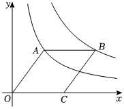

27. （2024•深圳）如图，在平面直角坐标系中，四边形 $AOCB$ 为菱形，$sin\angle AOC=\frac{4}{5}$，且点 $A$ 落在反比例函数 $y=\frac{3}{x}$（$x>0$）上，点 $B$ 落在反比例函数 $y=\frac{k}{x}$（$x>0$）上，则 $k=$ ___ ．

> [!question]- 点击查看答案与解析
> 【答案】$8$
> 
> 【考点】菱形坐标、锐角三角函数与反比例函数 → [[【初中数学知识点体系-人教版】#21-2 特殊的平行四边形]]、锐角三角函数 → [[【初中数学知识点体系-人教版】#32-1 锐角三角函数]]、反比例函数 → [[【初中数学知识点体系-人教版】#27-1 反比例函数]]
> 
> 【解析】
> 设 $OA=s$，$\sin\angle AOC=\dfrac{4}{5}$，则 $\cos\angle AOC=\dfrac{3}{5}$，$A\left(\dfrac{3s}{5},\dfrac{4s}{5}\right)$。
> $A$ 在 $y=\dfrac{3}{x}$ 上：$\dfrac{12s^2}{25}=3$，$s=\dfrac{5}{2}$。
> 菱形中 $B=A+C$，$C(s,0)$，故 $B\left(\dfrac{8s}{5},\dfrac{4s}{5}\right)$，$k=\dfrac{32s^2}{25}=8$。
> 
> 【易错点】菱形四边相等、对边平行；点的横、纵坐标由三角函数定义分解得到。
