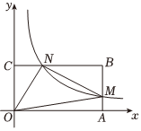

28. （2024•甘南州）如图，在平面直角坐标系 $xOy$ 中，矩形 $OABC$ 的两边 $OA$、$OC$ 分别在 $x$ 轴、$y$ 轴的正半轴上，反比例函数 $y=\frac{k}{x}$ 的图象与 $AB$ 相交于点 $M$，与 $BC$ 相交于点 $N$，若点 $B$ 的坐标为（4，2），$\triangle MON$ 的面积是 $\frac{15}{4}$，则 $k$ 的值为 ___ ．

> [!question]- 点击查看答案与解析
> 【答案】$2$
> 
> 【考点】矩形坐标与反比例函数面积割补 → [[【初中数学知识点体系-人教版】#27-1 反比例函数]]、坐标方法的简单应用 → [[【初中数学知识点体系-人教版】#9-2 坐标方法的简单应用]]
> 
> 【解析】
> $B(4,2)$，$M\left(4,\dfrac{k}{4}\right)$，$N\left(\dfrac{k}{2},2\right)$。
> 由坐标行列式 $S_{\triangle MON}=\dfrac{1}{2}\left|4\cdot2-\dfrac{k}{2}\cdot\dfrac{k}{4}\right|=4-\dfrac{k^2}{16}=\dfrac{15}{4}$，解得 $k^2=4$，由 $k>0$ 得 $k=2$。
> 
> 【易错点】矩形内三角形面积用矩形面积减去三个直角三角形面积；开方后按图象所在象限取正根。
