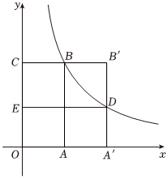

29. （2024•广州）如图，平面直角坐标系 $xOy$ 中，矩形 $OABC$ 的顶点 $B$ 在函数 $y=\frac{k}{x}$（$x>0$）的图象上，$A$（1，0），$C$（0，2）．将线段 $AB$ 沿 $x$ 轴正方向平移得线段 $A'B'$（点 $A$ 平移后的对应点为 $A′$），$A'B'$ 交函数 $y=\frac{k}{x}$（$x>0$）的图象于点 $D$，过点 $D$ 作 $DE\perp y$ 轴于点 $E$，则下列结论：
$①$ $k=2$；
$②$ $\triangle OBD$ 的面积等于四边形 $ABDA′$ 的面积；
$③$ $A'E$ 的最小值是 $\sqrt{2}$；
$④$ $\angle B'BD=\angle BB'O$．
其中正确的结论有 ___ ．（填写所有正确结论的序号）

> [!question]- 点击查看答案与解析
> 【答案】$①②④$
> 
> 【考点】反比例函数上点的坐标、平移与最值、角的大小比较 → [[【初中数学知识点体系-人教版】#27-1 反比例函数]]、平移 → [[【初中数学知识点体系-人教版】#7-4 平移]]、坐标方法的简单应用 → [[【初中数学知识点体系-人教版】#9-2 坐标方法的简单应用]]
> 
> 【解析】
> $A(1,0)$、$C(0,2)$，故 $B(1,2)$，$k=2$，$①$ 正确。
> 设平移距离为 $d$，$D\left(1+d,\dfrac{2}{1+d}\right)$。计算得 $S_{\triangle OBD}=S_{ABDA'}=\dfrac{d(2+d)}{1+d}$，$②$ 正确。
> $A'E^2=(1+d)^2+\dfrac{4}{(1+d)^2}\geq4$，最小值为 $2$，不是 $\sqrt2$，$③$ 错误。
> $④$ 设平移距离 $d$，$B'(1+d,2)$。$\angle B'BD$ 是 $BB'$（水平向右）与 $BD$ 的夹角，$\tan\angle B'BD=\dfrac{2d/(1+d)}{d}=\dfrac{2}{1+d}$；$\angle BB'O$ 是 $B'B$（水平向左）与 $B'O$ 的夹角，$\tan\angle BB'O=\dfrac{2}{1+d}$，两角均为锐角，故相等，$④$ 正确。
> 
> 【易错点】用均值不等式求最值时注意等号可以取到；比较角先判断锐角、钝角，不可只看正切值。
