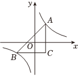

30. （2024•陕西）如图，点 $A$（3，$m$）和点 $B$（-5，$n$）在同一个反比例函数 $y=\frac{k}{x}$（$k>0$）的图象上，$AC$ 和 $BC$ 分别垂直于 $x$ 轴和 $y$ 轴．若 $\triangle ABC$ 的面积为32，则 $k$ 的值为 ___ ．

> [!question]- 点击查看答案与解析
> 【答案】$15$
> 
> 【考点】坐标法求直角三角形面积与反比例函数 → [[【初中数学知识点体系-人教版】#27-1 反比例函数]]、坐标方法的简单应用 → [[【初中数学知识点体系-人教版】#9-2 坐标方法的简单应用]]
> 
> 【解析】
> $A\left(3,\dfrac{k}{3}\right)$，$B\left(-5,-\dfrac{k}{5}\right)$，$C\left(3,-\dfrac{k}{5}\right)$。
> $AC=\dfrac{8k}{15}$，$BC=8$，$S_{\triangle ABC}=\dfrac{1}{2}\cdot8\cdot\dfrac{8k}{15}=\dfrac{32k}{15}=32$，解得 $k=15$。
> 
> 【易错点】两直角边分别平行于坐标轴；求纵坐标差时注意各点所在象限与符号。
