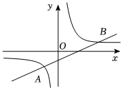

31. （2025•遂宁）如图，一次函数 $y=mx+n$（$m$，$n$ 为常数，$m\neq 0$）的图象与反比例函数 $y=\frac{k}{x}$（$k\neq 0$）的图象交于 $A$（-2，-2）、$B$（$a$，1）两点．
（1）求一次函数和反比例函数的关系式；
（2）结合图形，请直接写出不等式 $\frac{k}{x}-x<0$ 的解集；
（3）点 $P$（0，$b$）是 $y$ 轴上的一点，若 $\triangle ABP$ 是以 $AB$ 为直角边的直角三角形，求 $b$ 的值．

> [!question]- 点击查看答案与解析
> 【答案】（1）反比例函数 $y=\dfrac{4}{x}$，一次函数 $y=\dfrac{1}{2}x-1$；（2）$-2<x<0$ 或 $x>2$；（3）$b=-6$ 或 $9$
> 
> 【考点】待定系数法求解析式、图象法解不等式、直角三角形分类讨论 → [[【初中数学知识点体系-人教版】#27-1 反比例函数]]、一次函数 → [[【初中数学知识点体系-人教版】#23-1 一次函数]]、坐标方法的简单应用 → [[【初中数学知识点体系-人教版】#9-2 坐标方法的简单应用]]
> 
> 【解析】
> （1）$k=(-2)\times(-2)=4$，$B(4,1)$。直线斜率 $\dfrac{1-(-2)}{4-(-2)}=\dfrac{1}{2}$，代入 $A$ 得 $n=-1$。
> （2）不等式 $\dfrac{4}{x}<x$。联立 $y=\dfrac{4}{x}$ 与 $y=x$，得交点横坐标 $x=\pm2$；结合双曲线两支与直线 $y=x$ 的位置，解集为 $-2<x<0$ 或 $x>2$。
> （3）$AB$ 斜率为 $\dfrac{1}{2}$，与其垂直的直线斜率为 $-2$。直角在 $A$：$AP$ 斜率 $\dfrac{b+2}{2}=-2$，得 $b=-6$；直角在 $B$：$BP$ 斜率 $\dfrac{b-1}{-4}=-2$，得 $b=9$。
> 
> 【易错点】以 $AB$ 为直角边要分直角在 $A$、在 $B$ 两类；分式不等式解集必须结合图象分支，不能只看交点横坐标。
