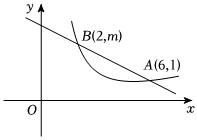

32. （2025•凉山州）如图，一次函数 $y_{1}=ax+b$ 的图象与反比例函数 $y_{2}=\frac{k}{x}$（$x>0$）的图象交于点 $A$（6，1），$B$（2，$m$）．
（1）求反比例函数和一次函数的解析式；
（2）利用图象，直接写出不等式 $ax+b>\frac{k}{x}$ 的解集为 ___ ；
（3）在 $x$ 轴上找一点 $C$，使 $\triangle ABC$ 的周长最小，并求出最小值．

> [!question]- 点击查看答案与解析
> 【答案】（1）反比例函数 $y=\dfrac{6}{x}$，一次函数 $y=-\dfrac{1}{2}x+4$；（2）$2<x<6$；（3）$C(5,0)$，周长最小值 $2\sqrt5+4\sqrt2$
> 
> 【考点】待定系数法、图象法解不等式、轴对称最短路径 → [[【初中数学知识点体系-人教版】#27-1 反比例函数]]、一次函数 → [[【初中数学知识点体系-人教版】#23-1 一次函数]]、图形的轴对称 → [[【初中数学知识点体系-人教版】#15-1 图形的轴对称]]、坐标方法的简单应用 → [[【初中数学知识点体系-人教版】#9-2 坐标方法的简单应用]]
> 
> 【解析】
> （1）$k=6$，$B(2,3)$。直线斜率 $\dfrac{3-1}{2-6}=-\dfrac{1}{2}$，代入 $A$ 得 $b=4$。
> （2）$ax+b>\dfrac{k}{x}$ 的图象区间为 $2<x<6$。
> （3）$AB$ 为定值，只需 $AC+BC$ 最小。作 $A$ 关于 $x$ 轴的对称点 $A'(6,-1)$，直线 $A'B$ 交 $x$ 轴于 $C(5,0)$。$AB=2\sqrt5$，$A'B=4\sqrt2$，周长最小值为 $2\sqrt5+4\sqrt2$。
> 
> 【易错点】周长最小化只折 $AC+BC$ 两段；对称点与另一点的连线和坐标轴的交点即为所求点。
