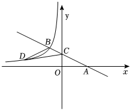

33. （2025•广元）如图，在平面直角坐标系 $xOy$ 中，一次函数 $y=kx+2$ 的图象分别与 $x$ 轴，$y$ 轴交于点 $A$，点 $C$，与反比例函数 $y=\frac{m}{x}$（$x<0$）的图象交于点 $B$（-2，3）．
（1）求一次函数和反比例函数的表达式；
（2）点 $D$（-6，$n$）是反比例函数 $y=\frac{m}{x}$ 图象上一点，连接 $BD$，$CD$，求 $\triangle BCD$ 的面积；
（3）点 $P$ 在 $y$ 轴上，满足 $\triangle PAB$ 是以 $AB$ 为斜边的直角三角形，请直接写出点 $P$ 的坐标．

> [!question]- 点击查看答案与解析
> 【答案】（1）一次函数 $y=-\dfrac{1}{2}x+2$，反比例函数 $y=-\dfrac{6}{x}$；（2）$S_{\triangle BCD}=4$；（3）$P\left(0,\dfrac{3+\sqrt{41}}{2}\right)$ 或 $P\left(0,\dfrac{3-\sqrt{41}}{2}\right)$
> 
> 【考点】待定系数法、坐标法求面积、直角三角形与垂直条件 → [[【初中数学知识点体系-人教版】#27-1 反比例函数]]、一次函数 → [[【初中数学知识点体系-人教版】#23-1 一次函数]]、坐标方法的简单应用 → [[【初中数学知识点体系-人教版】#9-2 坐标方法的简单应用]]
> 
> 【解析】
> （1）$B(-2,3)$ 在双曲线上，$m=-6$。代入直线 $y=kx+2$ 得 $k=-\dfrac{1}{2}$，$C(0,2)$，$A(4,0)$。
> （2）$D(-6,1)$，由鞋带公式 $S_{\triangle BCD}=4$。
> （3）$AB$ 为斜边，故 $\angle APB=90^\circ$，$PA\perp PB$。设 $P(0,p)$，$(4,-p)\cdot(-2,3-p)=0$，得 $p^2-3p-8=0$，$p=\dfrac{3\pm\sqrt{41}}{2}$。
> 
> 【易错点】斜边对应的直角顶点在以 $AB$ 为直径的圆上；用向量点积为零列方程时注意保留两个解。
