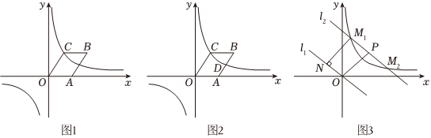

34. （2024•大庆）如图1，在平面直角坐标系中，$O$ 为坐标原点，点 $A$ 在 $x$ 轴的正半轴上．点 $B$，$C$ 在第一象限，四边形 $OABC$ 是平行四边形，点 $C$ 在反比例函数 $y=\frac{k}{x}$ 的图象上，点 $C$ 的横坐标为2．点 $B$ 的纵坐标为3．
提示：在平面直角坐标系中，若两点分别为 $P_{1}$（$x_{1}$，$y_{1}$），$P_{2}$（$x_{2}$，$y_{2}$），则 $P_{1}P_{2}$ 中点坐标为（$\frac{x1+x2}{2}$，$\frac{y1+y2}{2}$）．
（1）求反比例函数的表达式；
（2）如图2，点 $D$ 是 $AB$ 边的中点，且在反比例函数 $y=\frac{k}{x}$ 图象上，求平行四边形 $OABC$ 的面积；
（3）如图3，将直线 $l_{1}$：$y=-\frac{3}{4}x$ 向上平移 6 个单位得到直线 $l_{2}$，直线 $l_{2}$ 与函数 $y=\frac{k}{x}$（$x>0$）图象交于 $M_{1}$，$M_{2}$ 两点，点 $P$ 为 $M_{1}M_{2}$ 的中点，过点 $M_{1}$ 作 $M_{1}N\perp l_{1}$ 于点 $N$．请直接写出 $P$ 点坐标和 $\frac{M_{1}N}{OP}$ 的值．

> [!question]- 点击查看答案与解析
> 【答案】（1）$y=\dfrac{6}{x}$；（2）平行四边形面积为 $9$；（3）$P(4,3)$，$\dfrac{M_1N}{OP}=\dfrac{24}{25}$
> 
> 【考点】待定系数法、平行四边形坐标、中点与平行线间距离 → [[【初中数学知识点体系-人教版】#27-1 反比例函数]]、平行四边形 → [[【初中数学知识点体系-人教版】#21-1 平行四边形]]、坐标方法的简单应用 → [[【初中数学知识点体系-人教版】#9-2 坐标方法的简单应用]]
> 
> 【解析】
> （1）$A$ 在 $x$ 轴上，$C$ 横坐标为 $2$；平行四边形中 $y_B=y_A+y_C=3$，故 $y_C=3$，$k=2\times3=6$。
> （2）设 $A(a,0)$，$B(a+2,3)$，$D$ 为 $AB$ 中点 $\left(a+1,\dfrac{3}{2}\right)$，代入 $y=\dfrac{6}{x}$ 得 $a=3$。$A(3,0)$，$B(5,3)$，面积 $=3\times3=9$。
> （3）$l_2:y=-\dfrac{3}{4}x+6$ 与 $y=\dfrac{6}{x}$ 联立，中点 $P$ 的横坐标为两根平均数 $4$，$P(4,3)$。$M_1N$ 为两平行线 $l_1$、$l_2$ 间距离 $\dfrac{24}{5}$，$OP=5$，比值 $\dfrac{24}{25}$。
> 
> 【易错点】平行四边形对边纵坐标相等；二次方程两根中点横坐标为两根平均数；平行线间距离用 $\dfrac{|C_1-C_2|}{\sqrt{a^2+b^2}}$。
