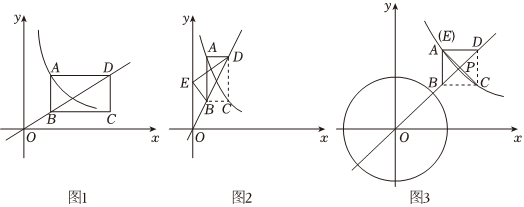

35. （2024•广东）【问题背景】
如图1，在平面直角坐标系中，点 $B$，$D$ 是直线 $y=ax$（$a>0$）上第一象限内的两个动点（$OD>OB$），以线段 $BD$ 为对角线作矩形 $ABCD$，$AD\parallel x$ 轴．反比例函数 $y=\frac{k}{x}$ 的图象经过点 $A$．
【构建联系】
（1）求证：函数 $y=\frac{k}{x}$ 的图象必经过点 $C$．
（2）如图2，把矩形 $ABCD$ 沿 $BD$ 折叠，点 $C$ 的对应点为 $E$．当点 $E$ 落在 $y$ 轴上，且点 $B$ 的坐标为（1，2）时，求 $k$ 的值．
【深入探究】
（3）如图3，把矩形 $ABCD$ 沿 $BD$ 折叠，点 $C$ 的对应点为 $E$．当点 $E$，$A$ 重合时，连接 $AC$ 交 $BD$ 于点 $P$．以点 $O$ 为圆心，$AC$ 长为半径作 $\odot O$．若 $OP=3\sqrt{2}$，当 $\odot O$ 与 $\triangle ABC$ 的边有交点时，求 $k$ 的取值范围．

> [!question]- 点击查看答案与解析
> 【答案】（1）见解析；（2）$k=\dfrac{16}{3}$；（3）$6\leq k\leq 8$
> 
> 【考点】矩形坐标证明、折叠反射与圆和三角形的位置关系探究 → [[【初中数学知识点体系-人教版】#27-1 反比例函数]]、图形的轴对称 → [[【初中数学知识点体系-人教版】#15-1 图形的轴对称]]、圆的基本性质 → [[【初中数学知识点体系-人教版】#29-1 圆的基本性质]]
> 
> 【解析】
> （1）设 $B(u,au)$，$D(v,av)$，由 $AD\parallel x$ 轴得 $A(u,av)$，$C(v,au)$。$A$ 在双曲线上 $k=u\cdot av=auv$，而 $v\cdot au=auv=k$，故点 $C$ 也在双曲线上。
> （2）$B(1,2)$ 在 $y=ax$ 上，$a=2$。$C(v,2)$ 关于直线 $y=2x$ 反射，其横坐标为 $\dfrac{8-3v}{5}$，落在 $y$ 轴上故为 $0$，$v=\dfrac{8}{3}$，$k=2v=\dfrac{16}{3}$。
> （3）$C$ 与 $A$ 重合时，$BD$ 垂直平分 $AC$，得 $a=1$，$u+v=6$。$P\left(\dfrac{u+v}{2},\dfrac{u+v}{2}\right)$，由 $OP=3\sqrt2$ 验证 $u+v=6$。圆半径 $AC=\sqrt2(v-u)$，圆与 $\triangle ABC$ 边有交点需 $R\geq OB=u\sqrt2$ 且 $R\leq\sqrt{u^2+v^2}$，解得 $3-\sqrt3\leq u\leq2$，$k=uv=u(6-u)\in[6,8]$。
> 
> 【易错点】折叠重合时折痕是对应点连线的垂直平分线；判断圆与三角形边有交点，要同时比较圆心到三角形的最近距离与最远距离。
