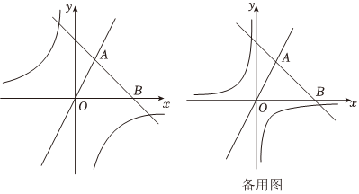

36. （2024•成都）如图，在平面直角坐标系 $xOy$ 中，直线 $y=-x+m$ 与直线 $y=2x$ 相交于点 $A$（2，$a$），与 $x$ 轴交于点 $B$（$b$，0），点 $C$ 在反比例函数 $y=\frac{k}{x}$（$k<0$）图象上．
（1）求 $a$，$b$，$m$ 的值；
（2）若 $O$，$A$，$B$，$C$ 为顶点的四边形为平行四边形，求点 $C$ 的坐标和 $k$ 的值；
（3）过 $A$，$C$ 两点的直线与 $x$ 轴负半轴交于点 $D$，点 $E$ 与点 $D$ 关于 $y$ 轴对称．若有且只有一点 $C$，使得 $\triangle ABD$ 与 $\triangle ABE$ 相似，求 $k$ 的值．

> [!question]- 点击查看答案与解析
> 【答案】（1）$a=4$，$b=6$，$m=6$；（2）$C(4,-4)$ 或 $C(-4,4)$，$k=-16$；（3）$k=-1$
> 
> 【考点】待定系数法、平行四边形顶点坐标、相似三角形探究 → [[【初中数学知识点体系-人教版】#27-1 反比例函数]]、一次函数 → [[【初中数学知识点体系-人教版】#23-1 一次函数]]、平行四边形 → [[【初中数学知识点体系-人教版】#21-1 平行四边形]]、相似三角形 → [[【初中数学知识点体系-人教版】#31-2 相似三角形]]
> 
> 【解析】
> （1）$A(2,a)$ 在 $y=2x$ 上，$a=4$；代入 $y=-x+m$ 得 $m=6$；$B(b,0)$ 代入得 $b=6$。
> （2）设 $C\\left(t,\\dfrac{k}{t}\\right)$，按对角线分类：① $AC$、$BO$ 为对角线，中点重合得 $C(4,-4)$；② $CB$、$AO$ 为对角线，中点重合得 $C(-4,4)$；③ $CO$、$AB$ 为对角线，得 $C(8,4)$，$k=32>0$ 舍去。故 $C(4,-4)$ 或 $(-4,4)$，$k=-16$。
> （3）设直线 $AC:y=px+4-2p$，则 $D\\left(\\dfrac{2p-4}{p},0\\right)$，$E\\left(\\dfrac{4-2p}{p},0\\right)$。$E$ 在 $B$ 左侧，$\\angle ABE=\\angle DBA$ 为公共角，相似只需 $\\dfrac{BE}{AB}=\\dfrac{AB}{BD}$，即 $BE\\cdot BD=AB^2=32$，解得 $p=1$，直线 $AC:y=x+2$。有且只有一点 $C$，即该直线与双曲线唯一交点（相切）：联立 $x+2=\\dfrac{k}{x}$，$x^2+2x-k=0$，$\\Delta=4+4k=0$，得 $k=-1$。
> 
> 【易错点】平行四边形顶点未指定顺序时需分类；相似三角形对应顶点要按角的对应关系确定，不可默认顺序。
