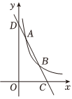

37. （2024•眉山）如图，在平面直角坐标系 $xOy$ 中，一次函数 $y=kx+b$ 与反比例函数 $y=\frac{m}{x}$（$x>0$）的图象交于点 $A$（1，6），$B$（$n$，2），与 $x$ 轴，$y$ 轴分别交于 $C$，$D$ 两点．
（1）求一次函数和反比例函数的表达式；
（2）若点 $P$ 在 $y$ 轴上，当 $\triangle PAB$ 的周长最小时，请直接写出点 $P$ 的坐标；
（3）将直线 $AB$ 向下平移 $a$ 个单位长度后与 $x$ 轴，$y$ 轴分别交于 $E$，$F$ 两点，当 $EF=\frac{1}{2}AB$ 时，求 $a$ 的值．

> [!question]- 点击查看答案与解析
> 【答案】（1）一次函数 $y=-2x+8$，反比例函数 $y=\dfrac{6}{x}$；（2）$P(0,5)$；（3）$a=6$
> 
> 【考点】待定系数法、轴对称最短路径、直线平移与线段长度 → [[【初中数学知识点体系-人教版】#27-1 反比例函数]]、一次函数 → [[【初中数学知识点体系-人教版】#23-1 一次函数]]、图形的轴对称 → [[【初中数学知识点体系-人教版】#15-1 图形的轴对称]]、坐标方法的简单应用 → [[【初中数学知识点体系-人教版】#9-2 坐标方法的简单应用]]
> 
> 【解析】
> （1）$m=6$，$B(3,2)$。直线斜率 $\dfrac{2-6}{3-1}=-2$，代入 $A$ 得 $b=8$。
> （2）周长最小时折 $PA+PB$，作 $A$ 关于 $y$ 轴的对称点 $A'(-1,6)$，直线 $A'B:y=-x+5$，交 $y$ 轴于 $P(0,5)$。
> （3）平移后直线 $y=-2x+8-a$，$E\left(\dfrac{8-a}{2},0\right)$，$F(0,8-a)$，$EF=\dfrac{(8-a)\sqrt5}{2}$。$AB=2\sqrt5$，由 $EF=\dfrac{1}{2}AB=\sqrt5$ 得 $a=6$。
> 
> 【易错点】最短路径问题只折两条线段；直线平移不改变斜率，截距随平移量变化。
