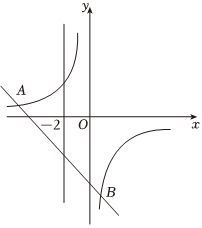

38. （2024•自贡）如图，在平面直角坐标系中，一次函数 $y=kx+b$ 的图象与反比例函数 $y=\frac{m}{x}$ 的图象交于 $A$（-6，1），$B$（1，$n$）两点．
（1）求反比例函数和一次函数的解析式；
（2）$P$ 是直线 $x=-2$ 上的一个动点，$\triangle PAB$ 的面积为21，求点 $P$ 坐标；
（3）点 $Q$ 在反比例函数 $y=\frac{m}{x}$ 位于第四象限的图象上，$\triangle QAB$ 的面积为 21，请直接写出 $Q$ 点坐标．

> [!question]- 点击查看答案与解析
> 【答案】（1）反比例函数 $y=-\dfrac{6}{x}$，一次函数 $y=-x-5$；（2）$P(-2,3)$ 或 $P(-2,-9)$；（3）$Q(3,-2)$ 或 $Q\left(\dfrac{-11+\sqrt{145}}{2},-\dfrac{11+\sqrt{145}}{2}\right)$
> 
> 【考点】待定系数法、坐标法求面积与分类讨论 → [[【初中数学知识点体系-人教版】#27-1 反比例函数]]、一次函数 → [[【初中数学知识点体系-人教版】#23-1 一次函数]]、坐标方法的简单应用 → [[【初中数学知识点体系-人教版】#9-2 坐标方法的简单应用]]
> 
> 【解析】
> （1）$m=-6$，$B(1,-6)$。直线斜率 $-1$，代入 $A$ 得 $b=-5$。
> （2）直线 $AB:x+y+5=0$，$AB=7\sqrt2$。$P(-2,y_P)$，$S=\dfrac{7|y_P+3|}{2}=21$，得 $y_P=3$ 或 $-9$。
> （3）设 $Q\left(q,-\dfrac{6}{q}\right)$，$S=\dfrac{7\left|q-\dfrac{6}{q}+5\right|}{2}=21$，即 $\left|q-\dfrac{6}{q}+5\right|=6$，解得 $q=3$ 或 $q=\dfrac{-11+\sqrt{145}}{2}$，对应两点均在第四象限。
> 
> 【易错点】动点在定直线或双曲线上时，面积条件通常对应两个位置，注意上下、左右分类，不要漏解。
