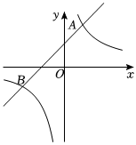

39. （2024•宜宾）如图，一次函数 $y=ax+b$（$a\neq 0$）的图象与反比例函数 $y=\frac{k}{x}$（$k\neq 0$）的图象交于点 $A$（1，4）、$B$（$n$，-1）．
（1）求反比例函数和一次函数的表达式；
（2）利用图象，直接写出不等式 $ax+b<\frac{k}{x}$ 的解集；
（3）已知点 $D$ 在 $x$ 轴上，点 $C$ 在反比例函数图象上．若以 $A$、$B$、$C$、$D$ 为顶点的四边形是平行四边形，求点 $C$ 的坐标．

> [!question]- 点击查看答案与解析
> 【答案】（1）反比例函数 $y=\dfrac{4}{x}$，一次函数 $y=x+3$；（2）$x<-4$ 或 $0<x<1$；（3）$C\left(\dfrac{4}{5},5\right)$、$C\left(-\dfrac{4}{5},-5\right)$ 或 $C\left(\dfrac{4}{3},3\right)$
> 
> 【考点】待定系数法、图象比较大小、平行四边形顶点坐标分类 → [[【初中数学知识点体系-人教版】#27-1 反比例函数]]、一次函数 → [[【初中数学知识点体系-人教版】#23-1 一次函数]]、平行四边形 → [[【初中数学知识点体系-人教版】#21-1 平行四边形]]
> 
> 【解析】
> （1）$k=4$，$B(-4,-1)$。直线斜率 $1$，代入 $A$ 得 $b=3$。
> （2）$x+3<\dfrac{4}{x}$，结合交点 $x=-4$、$x=1$ 及两支位置，解集为 $x<-4$ 或 $0<x<1$。
> （3）设 $D(d,0)$。$AB$ 为边时 $C=A+D-B=\left(\dfrac{4}{5},5\right)$ 或 $C=B+D-A=\left(-\dfrac{4}{5},-5\right)$；$AB$ 为对角线时 $C=A+B-D=\left(\dfrac{4}{3},3\right)$。
> 
> 【易错点】平行四边形四顶点未指定顺序时，按 $AB$ 为边（两种方向）与 $AB$ 为对角线分类，利用中点坐标相等求解。
