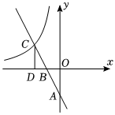

40. （2024•南充）如图，直线 $y=kx+b$ 经过 $A$（0，-2），$B$（-1，0）两点，与双曲线 $y=\frac{m}{x}$（$x<0$）交于点 $C$（$a$，2）．
（1）求直线和双曲线的解析式．
（2）过点 $C$ 作 $CD\perp x$ 轴于点 $D$，点 $P$ 在 $x$ 轴上，若以 $O$，$A$，$P$ 为顶点的三角形与 $\triangle BCD$ 相似，直接写出点 $P$ 的坐标．

> [!question]- 点击查看答案与解析
> 【答案】（1）直线 $y=-2x-2$，双曲线 $y=-\dfrac{4}{x}$；（2）$P(1,0)$、$(-1,0)$、$(4,0)$、$(-4,0)$
> 
> 【考点】待定系数法、相似三角形分类讨论 → [[【初中数学知识点体系-人教版】#27-1 反比例函数]]、一次函数 → [[【初中数学知识点体系-人教版】#23-1 一次函数]]、相似三角形 → [[【初中数学知识点体系-人教版】#31-2 相似三角形]]、坐标方法的简单应用 → [[【初中数学知识点体系-人教版】#9-2 坐标方法的简单应用]]
> 
> 【解析】
> （1）直线过 $A(0,-2)$、$B(-1,0)$，$y=-2x-2$；$C(a,2)$ 代入得 $a=-2$，$m=-4$。
> （2）$D(-2,0)$，$\triangle BCD$ 直角边 $BD=1$，$CD=2$。$\triangle OAP$ 直角在 $O$，$OA=2$，$OP=|p|$。相似比为 $2:1$ 或 $1:2$，得 $|p|=1$ 或 $4$。
> 
> 【易错点】相似三角形未指定对应边时，两种直角边比都要考虑；$P$ 在 $x$ 轴上需取正、负两个方向。
