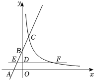

41. （2024•淮安）如图，在平面直角坐标系中，一次函数 $y=k_{1}x+b$ 的图象与 $x$ 轴、$y$ 轴分别交于点 $A$、$B$，与反比例函数 $y=\frac{k2}{x}$（$x>0$）的图象交于点 $C$．已知点 $A$ 坐标为（-1，0），点 $C$ 坐标为（1，3）．
（1）求反比例函数及一次函数的表达式；
（2）点 $D$ 在线段 $OB$ 上，过点 $D$ 且平行于 $x$ 轴的直线交 $AB$ 于点 $E$，交反比例函数图象于点 $F$．当 $DO=2ED$ 时，求点 $F$ 的坐标．

> [!question]- 点击查看答案与解析
> 【答案】（1）反比例函数 $y=\dfrac{3}{x}$，一次函数 $y=\dfrac{3}{2}x+\dfrac{3}{2}$；（2）$F\left(\dfrac{7}{2},\dfrac{6}{7}\right)$
> 
> 【考点】待定系数法、平行线与线段比例 → [[【初中数学知识点体系-人教版】#27-1 反比例函数]]、一次函数 → [[【初中数学知识点体系-人教版】#23-1 一次函数]]、坐标方法的简单应用 → [[【初中数学知识点体系-人教版】#9-2 坐标方法的简单应用]]
> 
> 【解析】
> （1）$k_2=1\times3=3$。直线过 $A(-1,0)$、$C(1,3)$，斜率 $\dfrac{3}{2}$，$b=\dfrac{3}{2}$，$B\left(0,\dfrac{3}{2}\right)$。
> （2）设 $D(0,d)$，水平线交 $AB$ 于 $E$，$x_E=\dfrac{2d}{3}-1<0$，$ED=1-\dfrac{2d}{3}$。由 $DO=2ED$：$d=2\left(1-\dfrac{2d}{3}\right)$，$d=\dfrac{6}{7}$。$F$ 在双曲线上，$x_F=\dfrac{3}{d}=\dfrac{7}{2}$。
> 
> 【易错点】$E$ 在 $y$ 轴左侧时 $ED$ 取横坐标的绝对值；水平线上各点纵坐标相同。
