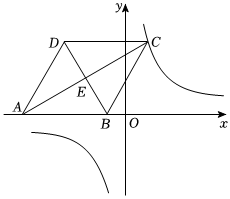

42. （2024•绵阳）如图，在边长为4的菱形 $ABCD$ 中，对角线 $AC$ 与 $BD$ 相交于点 $E$，边 $AB$ 在 $x$ 轴上，$\angle BAD=60^\circ$，$B$（-1，0），点 $C$ 在反比例函数 $y=\frac{k}{x}（k\neq 0）$ 的图象上．
（1）求点 $C$，$D$，$E$ 的坐标及反比例函数的解析式；
（2）将菱形 $ABCD$ 向右平移，当点 $E$ 恰好在反比例函数的图象上时，边 $BC$ 与函数图象交于点 $F$，求点 $F$ 到 $x$ 轴的距离．

> [!question]- 点击查看答案与解析
> 【答案】（1）$C(1,2\sqrt3)$，$D(-3,2\sqrt3)$，$E(-2,\sqrt3)$，反比例函数 $y=\dfrac{2\sqrt3}{x}$；（2）点 $F$ 到 $x$ 轴的距离为 $\dfrac{\sqrt3(\sqrt{17}-3)}{2}$
> 
> 【考点】菱形坐标、平移与直线和双曲线交点 → [[【初中数学知识点体系-人教版】#21-2 特殊的平行四边形]]、平移 → [[【初中数学知识点体系-人教版】#7-4 平移]]、反比例函数 → [[【初中数学知识点体系-人教版】#27-1 反比例函数]]、坐标方法的简单应用 → [[【初中数学知识点体系-人教版】#9-2 坐标方法的简单应用]]
> 
> 【解析】
> （1）$AB=4$，$B(-1,0)$，故 $A(-5,0)$。$\angle BAD=60^\circ$，$AD=4$，$D(-3,2\sqrt3)$，$C=B+\overrightarrow{AD}=(1,2\sqrt3)$，$E$ 为 $AC$ 中点 $(-2,\sqrt3)$，$k=1\times2\sqrt3=2\sqrt3$。
> （2）$E$ 平移到双曲线上时纵坐标 $\sqrt3$，横坐标为 $2$，即向右平移 $4$ 个单位。$B'(3,0)$，$C'(5,2\sqrt3)$，直线 $B'C':y=\sqrt3(x-3)$。联立 $y=\dfrac{2\sqrt3}{x}$，得 $x^2-3x-2=0$，$x=\dfrac{3+\sqrt{17}}{2}$，$F$ 到 $x$ 轴距离 $y=\sqrt3(x-3)=\dfrac{\sqrt3(\sqrt{17}-3)}{2}$。
> 
> 【易错点】菱形对边平行且相等；平移后对应点连线平行且相等，直线斜率保持不变。
