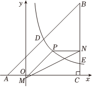

43. （2024•苏州）如图，$\triangle ABC$ 中，$AC=BC$，$\angle ACB=90^\circ$，$A$（-2，0），$C$（6，0），反比例函数 $y=\frac{k}{x}$（$k\neq 0$，$x>0$）的图象与 $AB$ 交于点 $D$（$m$，4），与 $BC$ 交于点 $E$．
（1）求 $m$，$k$ 的值；
（2）点 $P$ 为反比例函数 $y=\frac{k}{x}$（$k\neq 0$，$x>0$）图象上一动点（点 $P$ 在 $D$，$E$ 之间运动，不与 $D$，$E$ 重合），过点 $P$ 作 $PM\parallel AB$，交 $y$ 轴于点 $M$，过点 $P$ 作 $PN\parallel x$ 轴，交 $BC$ 于点 $N$，连接 $MN$，求 $\triangle PMN$ 面积的最大值，并求出此时点 $P$ 的坐标．

> [!question]- 点击查看答案与解析
> 【答案】（1）$m=2$，$k=8$；（2）$\triangle PMN$ 面积最大值为 $\dfrac{9}{2}$，此时 $P\left(3,\dfrac{8}{3}\right)$
> 
> 【考点】待定系数法、等腰直角三角形坐标与二次函数最值 → [[【初中数学知识点体系-人教版】#27-1 反比例函数]]、二次函数的图象与性质 → [[【初中数学知识点体系-人教版】#26-1 二次函数的图象与性质]]、坐标方法的简单应用 → [[【初中数学知识点体系-人教版】#9-2 坐标方法的简单应用]]
> 
> 【解析】
> （1）$AC=BC$，$\angle ACB=90^\circ$，$A(-2,0)$，$C(6,0)$，故 $B(6,8)$。$AB:y=x+2$，$D(m,4)$ 代入得 $m=2$，$k=2\times4=8$。
> （2）设 $P\left(p,\dfrac{8}{p}\right)$，$N\left(6,\dfrac{8}{p}\right)$，$PN=6-p$。$PM\parallel AB$（斜率 $1$），$M\left(0,\dfrac{8}{p}-p\right)$，$P$ 到 $M$ 的竖直距离为 $p$。$S_{\triangle PMN}=\dfrac{1}{2}(6-p)p=3p-\dfrac{p^2}{2}$，当 $p=3$ 时取最大值 $\dfrac{9}{2}$，$P\left(3,\dfrac{8}{3}\right)$。
> 
> 【易错点】平行于已知直线的直线斜率相同；面积最值化为二次函数顶点问题，注意动点 $P$ 在 $D$、$E$ 之间的取值范围。
