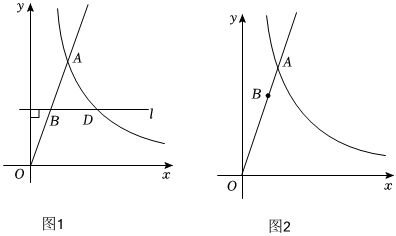

44. （2024•济南）已知反比例函数 $y=\frac{k}{x}（x>0）$ 的图象与正比例函数 $y=3x$（$x\geq 0$）的图象交于点 $A$（2，$a$），点 $B$ 是线段 $OA$ 上（不与点 $A$ 重合）的一点．
（1）求反比例函数的表达式；
（2）如图1，过点 $B$ 作 $y$ 轴的垂线 $l$，$l$ 与 $y=\frac{k}{x}（x>0）$ 的图象交于点 $D$，当线段 $BD=3$ 时，求点 $B$ 的坐标；
（3）如图2，将点 $A$ 绕点 $B$ 顺时针旋转 $90^\circ$ 得到点 $E$，当点 $E$ 恰好落在 $y=\frac{k}{x}（x>0）$ 的图象上时，求点 $E$ 的坐标．

> [!question]- 点击查看答案与解析
> 【答案】（1）$y=\dfrac{12}{x}$；（2）$B(1,3)$；（3）$E(3,4)$
> 
> 【考点】待定系数法、坐标旋转与反比例函数 → [[【初中数学知识点体系-人教版】#27-1 反比例函数]]、图形的旋转 → [[【初中数学知识点体系-人教版】#28-1 图形的旋转]]、坐标方法的简单应用 → [[【初中数学知识点体系-人教版】#9-2 坐标方法的简单应用]]
> 
> 【解析】
> （1）$A(2,6)$，$k=12$。
> （2）设 $B(t,3t)$，水平线交双曲线于 $D\left(\dfrac{4}{t},3t\right)$，$BD=\dfrac{4}{t}-t=3$，解得 $t=1$，$B(1,3)$。
> （3）$\overrightarrow{BA}=(2-t,6-3t)$，顺时针旋转 $90^\circ$ 得 $(6-3t,t-2)$，$E=(6-2t,4t-2)$。代入双曲线：$(6-2t)(4t-2)=12$，解得 $t=\dfrac{3}{2}$（$t=2$ 与 $A$ 重合，舍去），$E(3,4)$。
> 
> 【易错点】顺时针与逆时针旋转的坐标变换方向不同；注意舍去与已知点重合的解。
