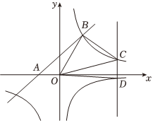

45. （2024•泸州）如图，在平面直角坐标系 $xOy$ 中，一次函数 $y=kx+b$ 与 $x$ 轴相交于点 $A$（-2，0），与反比例函数 $y=\frac{a}{x}$ 的图象相交于点 $B$（2，3）．
（1）求一次函数和反比例函数的解析式；
（2）直线 $x=m$（$m>2$）与反比例函数 $y=\frac{a}{x}$（$x>0$）和 $y=-\frac{2}{x}$（$x>0$）的图象分别交于点 $C$，$D$，且 $S_{\triangle OBC}=2S_{\triangle OCD}$，求点 $C$ 的坐标．

> [!question]- 点击查看答案与解析
> 【答案】（1）一次函数 $y=\dfrac{3}{4}x+\dfrac{3}{2}$，反比例函数 $y=\dfrac{6}{x}$；（2）$C(6,1)$
> 
> 【考点】待定系数法、坐标法面积比 → [[【初中数学知识点体系-人教版】#27-1 反比例函数]]、一次函数 → [[【初中数学知识点体系-人教版】#23-1 一次函数]]、坐标方法的简单应用 → [[【初中数学知识点体系-人教版】#9-2 坐标方法的简单应用]]
> 
> 【解析】
> （1）$a=2\times3=6$。直线过 $A(-2,0)$、$B(2,3)$，斜率 $\dfrac{3}{4}$，$b=\dfrac{3}{2}$。
> （2）$C\left(m,\dfrac{6}{m}\right)$，$D\left(m,-\dfrac{2}{m}\right)$，$S_{\triangle OCD}=4$。$S_{\triangle OBC}=\dfrac{3m}{2}-\dfrac{6}{m}=2S_{\triangle OCD}=8$，解得 $m=6$，$C(6,1)$。
> 
> 【易错点】面积比转化为方程时注意点所在象限带来的符号；$m>2$ 时去绝对值取正。
