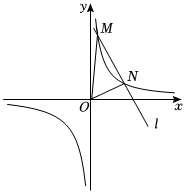

46. （2024•雅安）如图，在平面直角坐标系中，一次函数的图象 $l$ 与反比例函数 $y=\frac{k}{x}$ 的图象交于 $M$（$\frac{1}{2}$，4），$N$（$n$，1）两点．
（1）求反比例函数及一次函数的表达式；
（2）求 $\triangle OMN$ 的面积；
（3）若点 $P$ 是 $y$ 轴上一动点，连接 $PM$，$PN$．当 $PM+PN$ 的值最小时，求点 $P$ 的坐标．

> [!question]- 点击查看答案与解析
> 【答案】（1）反比例函数 $y=\dfrac{2}{x}$，一次函数 $y=-2x+5$；（2）$S_{\triangle OMN}=\dfrac{15}{4}$；（3）$P\left(0,\dfrac{17}{5}\right)$
> 
> 【考点】待定系数法、坐标法面积、轴对称最短路径 → [[【初中数学知识点体系-人教版】#27-1 反比例函数]]、一次函数 → [[【初中数学知识点体系-人教版】#23-1 一次函数]]、图形的轴对称 → [[【初中数学知识点体系-人教版】#15-1 图形的轴对称]]、坐标方法的简单应用 → [[【初中数学知识点体系-人教版】#9-2 坐标方法的简单应用]]
> 
> 【解析】
> （1）$k=\dfrac{1}{2}\times4=2$，$N(2,1)$。直线斜率 $-2$，代入 $M$ 得 $b=5$。
> （2）由鞋带公式 $S_{\triangle OMN}=\dfrac{15}{4}$。
> （3）作 $M$ 关于 $y$ 轴的对称点 $M'\left(-\dfrac{1}{2},4\right)$，直线 $M'N$ 交 $y$ 轴于 $P\left(0,\dfrac{17}{5}\right)$。
> 
> 【易错点】最短路径问题折 $PM+PN$ 两段；关于 $y$ 轴对称时点纵坐标不变、横坐标反号。
