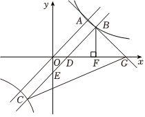

47. （2024•烟台）如图，正比例函数 $y=x$ 与反比例函数 $y=\frac{k}{x}$ 的图象交于点 $A$（$\sqrt{6}$，$a$）．将正比例函数图象向下平移 $n$（$n>0$）个单位后，与反比例函数图象在第一、三象限交于点 $B$，$C$，与 $x$ 轴，$y$ 轴交于点 $D$，$E$，且满足 $BE:CE=3:2$，过点 $B$ 作 $BF\perp x$ 轴，垂足为点 $F$，$G$ 为 $x$ 轴上一点，直线 $BC$ 与 $BG$ 关于直线 $BF$ 成轴对称，连接 $CG$．
（1）求反比例函数的表达式；
（2）求 $n$ 的值及 $\triangle BCG$ 的面积．

> [!question]- 点击查看答案与解析
> 【答案】（1）$y=\dfrac{6}{x}$；（2）$n=1$，$S_{\triangle BCG}=10$
> 
> 【考点】待定系数法、平移、轴对称与坐标法面积 → [[【初中数学知识点体系-人教版】#27-1 反比例函数]]、平移 → [[【初中数学知识点体系-人教版】#7-4 平移]]、图形的轴对称 → [[【初中数学知识点体系-人教版】#15-1 图形的轴对称]]、坐标方法的简单应用 → [[【初中数学知识点体系-人教版】#9-2 坐标方法的简单应用]]
> 
> 【解析】
> （1）$A(\sqrt6,\sqrt6)$，$k=6$。
> （2）平移后直线 $y=x-n$，交点横坐标满足 $x^2-nx-6=0$。由 $BE:CE=3:2$ 得 $x_B=3$，$x_C=-2$，$n=x_B+x_C=1$。$B(3,2)$，$C(-2,-3)$。$BF$ 为直线 $x=3$，$BC$ 关于 $BF$ 对称的直线斜率为 $-1$，交 $x$ 轴于 $G(5,0)$。由鞋带公式 $S_{\triangle BCG}=10$。
> 
> 【易错点】同一直线上的线段比等于横坐标差之比；关于竖直线对称的两条直线斜率互为相反数。
