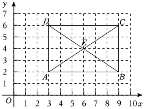

49. （2024•河南）如图，矩形 $ABCD$ 的四个顶点都在格点（网格线的交点）上，对角线 $AC$，$BD$ 相交于点 $E$，反比例函数 $y=\frac{k}{x}（x>0）$ 的图象经过点 $A$．
（1）求这个反比例函数的表达式．
（2）请先描出这个反比例函数图象上不同于点 $A$ 的三个格点，再画出反比例函数的图象．
（3）将矩形 $ABCD$ 向左平移，当点 $E$ 落在这个反比例函数的图象上时，平移的距离为 ___ ．

> [!question]- 点击查看答案与解析
> 【答案】（1）$y=\dfrac{6}{x}$；（2）如 $(1,6)$、$(2,3)$、$(6,1)$（描点连线略）；（3）平移距离 $\dfrac{9}{2}$
> 
> 【考点】待定系数法、格点与平移 → [[【初中数学知识点体系-人教版】#27-1 反比例函数]]、平移 → [[【初中数学知识点体系-人教版】#7-4 平移]]、坐标方法的简单应用 → [[【初中数学知识点体系-人教版】#9-2 坐标方法的简单应用]]
> 
> 【解析】
> （1）由网格得 $A(3,2)$，$k=6$。
> （2）$y=\dfrac{6}{x}$ 上的格点还有 $(1,6)$、$(2,3)$、$(6,1)$ 等，描点后画出双曲线。
> （3）由网格得 $A(3,2)$、$C(9,6)$，$E$ 为 $AC$ 中点 $(6,4)$。向左平移后 $E'$ 纵坐标仍为 $4$，代入 $y=\dfrac{6}{x}$ 得 $x=\dfrac{3}{2}$，平移距离 $6-\dfrac{3}{2}=\dfrac{9}{2}$。
> 
> 【易错点】矩形对角线交点为两对角顶点的中点；平移过程中点的纵坐标保持不变。
