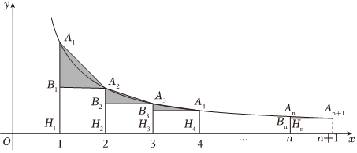

50. （2024•青岛）如图，点 $A_{1}$，$A_{2}$，$A_{3}$，…，$A_{n}$，$A_{n+1}$ 为反比例函数 $y=\frac{k}{x}$（$k>0$）图象上的点，其横坐标依次为1，2，3，…，$n$，$n+1$．过点 $A_{1}$，$A_{2}$，$A_{3}$，…，$A_{n}$ 作 $x$ 轴的垂线，垂足分别为点 $H_{1}$，$H_{2}$，$H_{3}$，…，$H_{n}$；过点 $A_{2}$ 作 $A_{2}B_{1}\perp A_{1}H_{1}$ 于点 $B_{1}$，过点 $A_{3}$ 作 $A_{3}B_{2}\perp A_{2}H_{2}$ 于点 $B_{2}$，…，过点 $A_{n+1}$ 作 $A_{n+1}B_{n}\perp A_{n}H_{n}$ 于点 $B_{n}$．
记 $\triangle A_{1}B_{1}A_{2}$ 的面积为 $S_{1}$，$\triangle A_{2}B_{2}A_{3}$ 的面积为 $S_{2}$，…，$\triangle A_{n}B_{n}A_{n+1}$ 的面积为 $S_{n}$．
（1）当 $k=2$ 时，点 $B_{1}$ 的坐标为 ___ ，
$S_{1}+S_{2}=$ ___ ，
$S_{1}+S_{2}+S_{3}=$ ___ ，
$S_{1}+S_{2}+S_{3}+\cdots+S_{n}=$ ___ （用含 $n$ 的代数式表示）；
（2）当 $k=3$ 时，$S_{1}+S_{2}+S_{3}+\cdots+S_{n}=$ ___ （用含 $n$ 的代数式表示）．

> [!question]- 点击查看答案与解析
> 【答案】（1）$B_1(1,1)$；$S_1+S_2=\dfrac{2}{3}$；$S_1+S_2+S_3=\dfrac{3}{4}$；$S_1+S_2+\cdots+S_n=\dfrac{n}{n+1}$；（2）$\dfrac{3n}{2(n+1)}$
> 
> 【考点】反比例函数上点的坐标、规律探究与裂项求和 → [[【初中数学知识点体系-人教版】#27-1 反比例函数]]、坐标方法的简单应用 → [[【初中数学知识点体系-人教版】#9-2 坐标方法的简单应用]]
> 
> 【解析】
> $k=2$ 时 $A_i=\left(i,\dfrac{2}{i}\right)$，$B_1=(1,1)$。$S_i=\dfrac{1}{2}\cdot1\cdot\left|\dfrac{2}{i}-\dfrac{2}{i+1}\right|=\dfrac{1}{i(i+1)}$。
> $S_1+S_2=\dfrac{1}{2}+\dfrac{1}{6}=\dfrac{2}{3}$；再加 $S_3=\dfrac{1}{12}$ 得 $\dfrac{3}{4}$；裂项求和 $\sum_{i=1}^{n}\dfrac{1}{i(i+1)}=1-\dfrac{1}{n+1}=\dfrac{n}{n+1}$。
> $k=3$ 时 $S_i=\dfrac{3}{2i(i+1)}$，求和得 $\dfrac{3n}{2(n+1)}$。
> 
> 【易错点】每个小三角形的水平直角边均为 $1$；裂项公式 $\dfrac{1}{i(i+1)}=\dfrac{1}{i}-\dfrac{1}{i+1}$。
