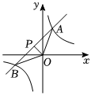

51. （2024•巴中）如图，在平面直角坐标系中，直线 $y=x+2$ 与反比例函数 $y=\frac{k}{x}（k\neq 0）$ 的图象交于 $A$、$B$ 两点，点 $A$ 的横坐标为1．
（1）求 $k$ 的值及点 $B$ 的坐标．
（2）点 $P$ 是线段 $AB$ 上一点，点 $M$ 在直线 $OB$ 上运动，当 $S\triangle BPO=\frac{1}{2}S\triangle ABO$ 时，求 $PM$ 的最小值．

> [!question]- 点击查看答案与解析
> 【答案】（1）$k=3$，$B(-3,-1)$；（2）$PM$ 的最小值为 $\dfrac{2\sqrt{10}}{5}$
> 
> 【考点】待定系数法、面积条件与点到直线距离 → [[【初中数学知识点体系-人教版】#27-1 反比例函数]]、一次函数 → [[【初中数学知识点体系-人教版】#23-1 一次函数]]、坐标方法的简单应用 → [[【初中数学知识点体系-人教版】#9-2 坐标方法的简单应用]]
> 
> 【解析】
> （1）$A$ 横坐标为 $1$，代入 $y=x+2$ 得 $A(1,3)$，$k=3$；联立 $x+2=\dfrac{3}{x}$ 得 $B(-3,-1)$。
> （2）$S_{\triangle ABO}=4$，故 $S_{\triangle BPO}=2$。设 $P(p,p+2)$，$S_{\triangle BPO}=|-p-3|=2$，由 $P$ 在线段 $AB$ 上取 $p=-1$，$P(-1,1)$。$OB:y=\dfrac{x}{3}$，$PM$ 最小值为 $P$ 到 $OB$ 的距离 $\dfrac{4}{\sqrt{10}}=\dfrac{2\sqrt{10}}{5}$。
> 
> 【易错点】面积条件通常求出两个横坐标，要按 $P$ 在线段 $AB$ 上取舍；点到直线的垂线段最短。
