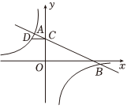

52. （2024•泰安）直线 $y_{1}=kx+b$（$k\neq 0$）与反比例函数 $y_{2}=-\frac{8}{x}$ 的图象相交于点 $A$（-2，$m$），$B$（$n$，-1），与 $y$ 轴交于点 $C$．
（1）求直线 $y_{1}$ 的表达式；
（2）若 $y_{1}>y_{2}$，请直接写出满足条件的 $x$ 的取值范围；
（3）过 $C$ 点作 $x$ 轴的平行线交反比例函数的图象于点 $D$，求 $\triangle ACD$ 的面积．

> [!question]- 点击查看答案与解析
> 【答案】（1）$y_1=-\dfrac{1}{2}x+3$；（2）$-2<x<0$ 或 $x>8$；（3）$S_{\triangle ACD}=\dfrac{4}{3}$
> 
> 【考点】待定系数法、图象比较大小与坐标法面积 → [[【初中数学知识点体系-人教版】#27-1 反比例函数]]、一次函数 → [[【初中数学知识点体系-人教版】#23-1 一次函数]]、坐标方法的简单应用 → [[【初中数学知识点体系-人教版】#9-2 坐标方法的简单应用]]
> 
> 【解析】
> （1）$A(-2,4)$，$B(8,-1)$，直线斜率 $-\dfrac{1}{2}$，$b=3$，$C(0,3)$。
> （2）$y_1>y_2$ 的图象区间为 $-2<x<0$ 或 $x>8$。
> （3）$CD\parallel x$ 轴，$y=3$，代入双曲线得 $D\left(-\dfrac{8}{3},3\right)$，$CD=\dfrac{8}{3}$，$A$ 到直线 $CD$ 的距离为 $1$，$S=\dfrac{1}{2}\cdot\dfrac{8}{3}\cdot1=\dfrac{4}{3}$。
> 
> 【易错点】分式不等式解集按两支分段；水平线上纵坐标相同，面积以水平线段为底。
