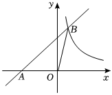

53. （2024•湖北）如图，一次函数 $y=x+m$ 的图象与 $x$ 轴交于点 $A$（-3，0），与反比例函数 $y=\frac{k}{x}$（$k$ 为常数，$k\neq 0$）的图象在第一象限的部分交于点 $B$（$n$，4）．
（1）求 $m$，$n$，$k$ 的值；
（2）若 $C$ 是反比例函数 $y=\frac{k}{x}$ 的图象在第一象限部分上的点，且 $\triangle AOC$ 的面积小于 $\triangle AOB$ 的面积，直接写出点 $C$ 的横坐标 $a$ 的取值范围．

> [!question]- 点击查看答案与解析
> 【答案】（1）$m=3$，$n=1$，$k=4$；（2）$a>1$
> 
> 【考点】待定系数法、面积比较与自变量取值范围 → [[【初中数学知识点体系-人教版】#27-1 反比例函数]]、一次函数 → [[【初中数学知识点体系-人教版】#23-1 一次函数]]、坐标方法的简单应用 → [[【初中数学知识点体系-人教版】#9-2 坐标方法的简单应用]]
> 
> 【解析】
> （1）$A(-3,0)$ 代入 $y=x+m$ 得 $m=3$；$B(n,4)$ 代入得 $n=1$，$k=1\times4=4$。
> （2）$S_{\triangle AOB}=6$。$S_{\triangle AOC}=\dfrac{1}{2}\cdot OA\cdot y_C=\dfrac{3y_C}{2}<6$，故 $y_C<4$，第一象限分支上 $x_C>1$，即 $a>1$。
> 
> 【易错点】同底三角形面积比等于高之比；第一象限分支上 $y$ 随 $x$ 增大而减小。
