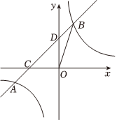

54. （2024•东营）如图，一次函数 $y=mx+n$（$m\neq 0$）的图象与反比例函数 $y=\frac{k}{x}$（$k\neq 0$）的图象交于点 $A$（-3，$a$），$B$（1，3），且一次函数与 $x$ 轴，$y$ 轴分别交于点 $C$，$D$．
（1）求反比例函数和一次函数的表达式；
（2）根据图象直接写出不等式 $mx+n>\frac{k}{x}$ 的解集；
（3）在第三象限的反比例函数图象上有一点 $P$，使得 $S_{\triangle OCP}=4S_{\triangle OBD}$，求点 $P$ 的坐标．

> [!question]- 点击查看答案与解析
> 【答案】（1）反比例函数 $y=\dfrac{3}{x}$，一次函数 $y=x+2$；（2）$-3<x<0$ 或 $x>1$；（3）$P\left(-\dfrac{3}{4},-4\right)$
> 
> 【考点】待定系数法、图象比较大小与坐标法面积 → [[【初中数学知识点体系-人教版】#27-1 反比例函数]]、一次函数 → [[【初中数学知识点体系-人教版】#23-1 一次函数]]、坐标方法的简单应用 → [[【初中数学知识点体系-人教版】#9-2 坐标方法的简单应用]]
> 
> 【解析】
> （1）$k=3$，$A(-3,-1)$；直线斜率 $1$，$b=2$。
> （2）$mx+n>\dfrac{k}{x}$ 的解集为 $-3<x<0$ 或 $x>1$。
> （3）$C(-2,0)$，$D(0,2)$，$S_{\triangle OBD}=1$。$S_{\triangle OCP}=4$：$\dfrac{1}{2}\cdot2\cdot\left|\dfrac{3}{p}\right|=4$，$|p|=\dfrac{3}{4}$，第三象限取 $p=-\dfrac{3}{4}$，$P\left(-\dfrac{3}{4},-4\right)$。
> 
> 【易错点】第三象限点的横、纵坐标均为负；面积先取绝对值，再按象限确定符号。
