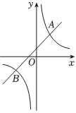

55. （2024•达州）如图，一次函数 $y=kx+b$（$k$，$b$ 为常数，$k\neq 0$）的图象与反比例函数 $y=\frac{m}{x}$（$m$ 为常数，$m\neq 0$）的图象交于点 $A$（2，3），$B$（$a$，-2）．
（1）求反比例函数和一次函数的解析式；
（2）若点 $C$ 是 $x$ 轴正半轴上的一点，且 $\angle BCA=90^\circ$，求点 $C$ 的坐标．

> [!question]- 点击查看答案与解析
> 【答案】（1）反比例函数 $y=\dfrac{6}{x}$，一次函数 $y=x+1$；（2）$C(3,0)$
> 
> 【考点】待定系数法、直角三角形与向量点积 → [[【初中数学知识点体系-人教版】#27-1 反比例函数]]、一次函数 → [[【初中数学知识点体系-人教版】#23-1 一次函数]]、坐标方法的简单应用 → [[【初中数学知识点体系-人教版】#9-2 坐标方法的简单应用]]
> 
> 【解析】
> （1）$m=2\times3=6$，$B(-3,-2)$；直线斜率 $1$，$b=1$。
> （2）设 $C(c,0)$，$\angle BCA=90^\circ$，$(B-C)\cdot(A-C)=0$：$(-3-c)(2-c)-6=0$，即 $c^2+c-12=0$，$c=3$（$c=-4$ 不合 $x$ 轴正半轴，舍去）。
> 
> 【易错点】直角在 $C$ 时两直角边向量点积为零；注意按点所在半轴舍去负根。
