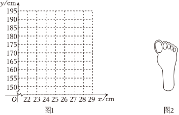

56. （2024•广州）一个人的脚印信息往往对应着这个人某些方面的基本特征．某数学兴趣小组收集了大量不同人群的身高和脚长数据，通过对数据的整理和分析，发现身高 $y$ 和脚长 $x$ 之间近似存在一个函数关系，部分数据如表：

| 脚长 $x$（cm） | … | 23 | 24 | 25 | 26 | 27 | 28 | … |
| --- | --- | --- | --- | --- | --- | --- | --- | --- |
| 身高 $y$（cm） | … | 156 | 163 | 170 | 177 | 184 | 191 | … |

（1）在图1中描出表中数据对应的点（$x$，$y$）；
（2）根据表中数据，从 $y=ax+b$（$a\neq 0$）和 $y=\frac{k}{x}$（$k\neq 0$）中选择一个函数模型，使它能近似地反映身高和脚长的函数关系，并求出这个函数的解析式（不要求写出 $x$ 的取值范围）；
（3）如图2，某场所发现了一个人的脚印，脚长约为 $25.8$ cm，请根据（2）中求出的函数解析式，估计这个人的身高．

> [!question]- 点击查看答案与解析
> 【答案】（1）描点略；（2）一次函数 $y=7x-5$；（3）约 $175.6$ cm
> 
> 【考点】待定系数法求一次函数解析式、函数模型选择与实际应用 → [[【初中数学知识点体系-人教版】#23-2 一次函数的应用]]、实际问题与反比例函数 → [[【初中数学知识点体系-人教版】#27-2 实际问题与反比例函数]]
> 
> 【解析】
> （2）表中 $x$ 每增加 $1$，$y$ 增加 $7$，数据呈线性关系，选 $y=ax+b$。代入 $(23,156)$ 得 $a=7$，$b=-5$，即 $y=7x-5$。
> （3）$x=25.8$ 时，$y=7\times25.8-5=175.6$ cm。
> 
> 【易错点】先判断数据呈线性还是反比例趋势；反比例模型要求 $xy$ 为定值，本题数据不满足。
