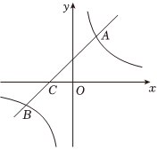

57. （2024•广安）如图，一次函数 $y=ax+b$（$a$，$b$ 为常数，$a\neq 0$）的图象与反比例函数 $y=\frac{k}{x}$（$k$ 为常数，$k\neq 0$）的图象交于 $A$（2，4），$B$（$n$，-2）两点．
（1）求一次函数和反比例函数的解析式；
（2）直线 $AB$ 与 $x$ 轴交于点 $C$，点 $P$（$m$，0）是 $x$ 轴上的点，若 $\triangle PAC$ 的面积大于 12，请直接写出 $m$ 的取值范围．

> [!question]- 点击查看答案与解析
> 【答案】（1）一次函数 $y=x+2$，反比例函数 $y=\dfrac{8}{x}$；（2）$m>4$ 或 $m<-8$
> 
> 【考点】待定系数法、坐标法面积与一元一次不等式 → [[【初中数学知识点体系-人教版】#27-1 反比例函数]]、一次函数 → [[【初中数学知识点体系-人教版】#23-1 一次函数]]、一元一次不等式 → [[【初中数学知识点体系-人教版】#11-2 一元一次不等式]]
> 
> 【解析】
> （1）$k=2\times4=8$，$B(-4,-2)$；直线斜率 $1$，$b=2$。
> （2）直线 $AB$ 交 $x$ 轴于 $C(-2,0)$。$S_{\triangle PAC}=\dfrac{1}{2}|m+2|\cdot4=2|m+2|>12$，故 $|m+2|>6$，$m>4$ 或 $m<-8$。
> 
> 【易错点】$P$ 在 $x$ 轴上左右两侧都要考虑；面积条件先化为绝对值不等式再求解。
