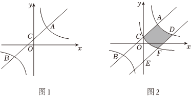

58. （2024•连云港）如图1，在平面直角坐标系 $xOy$ 中，一次函数 $y=kx+1$（$k\neq 0$）的图象与反比例函数 $y=\frac{6}{x}$ 的图象交于点 $A$、$B$，与 $y$ 轴交于点 $C$，点 $A$ 的横坐标为2．
（1）求 $k$ 的值；
（2）利用图象直接写出 $kx+1<\frac{6}{x}$ 时 $x$ 的取值范围；
（3）如图2，将直线 $AB$ 沿 $y$ 轴向下平移4个单位，与函数 $y=\frac{6}{x}（x>0）$ 的图象交于点 $D$，与 $y$ 轴交于点 $E$，再将函数 $y=\frac{6}{x}（x>0）$ 的图象沿 $AB$ 平移，使点 $A$、$D$ 分别平移到点 $C$、$F$ 处，求图中阴影部分的面积．

> [!question]- 点击查看答案与解析
> 【答案】（1）$k=1$；（2）$x<-3$ 或 $0<x<2$；（3）阴影部分面积为 $4$
> 
> 【考点】待定系数法、图象比较大小与平移图形面积 → [[【初中数学知识点体系-人教版】#27-1 反比例函数]]、一次函数 → [[【初中数学知识点体系-人教版】#23-1 一次函数]]、平移 → [[【初中数学知识点体系-人教版】#7-4 平移]]、坐标方法的简单应用 → [[【初中数学知识点体系-人教版】#9-2 坐标方法的简单应用]]
> 
> 【解析】
> （1）$A$ 横坐标为 $2$，代入 $y=\dfrac{6}{x}$ 得 $A(2,3)$，再代入 $y=kx+1$ 得 $k=1$。
> （2）两交点为 $x=2$、$x=-3$，$kx+1<\dfrac{6}{x}$ 的解集为 $x<-3$ 或 $0<x<2$。
> （3）平移向量 $\overrightarrow{AC}=(-2,-2)$，阴影为平移形成的平行四边形，面积 $|\overrightarrow{AC}\times\overrightarrow{AD}|=4$。
> 
> 【易错点】平移前后图形全等，扫过区域为平行四边形；面积用底乘高（或向量叉积）计算。
