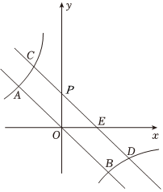

59. （2024•临夏州）如图，直线 $y=kx$ 与双曲线 $y=-\frac{4}{x}$ 交于 $A$，$B$ 两点，已知 $A$ 点坐标为（$a$，2）．
（1）求 $a$，$k$ 的值；
（2）将直线 $y=kx$ 向上平移 $m$（$m>0$）个单位长度，与双曲线 $y=-\frac{4}{x}$ 在第二象限的图象交于点 $C$，与 $x$ 轴交于点 $E$，与 $y$ 轴交于点 $P$，若 $PE=PC$，求 $m$ 的值．

> [!question]- 点击查看答案与解析
> 【答案】（1）$a=-2$，$k=-1$；（2）$m=\sqrt2$
> 
> 【考点】待定系数法、平移与等距点条件 → [[【初中数学知识点体系-人教版】#27-1 反比例函数]]、一次函数 → [[【初中数学知识点体系-人教版】#23-1 一次函数]]、坐标方法的简单应用 → [[【初中数学知识点体系-人教版】#9-2 坐标方法的简单应用]]
> 
> 【解析】
> （1）$A(a,2)$ 在 $y=-\dfrac{4}{x}$ 上，$2a=-4$，$a=-2$；代入 $y=kx$ 得 $-2k=2$，$k=-1$。
> （2）平移后 $y=-x+m$，$E(m,0)$，$P(0,m)$。设 $C(x,y)$，$PE=PC$，$PC^2=2x^2$，$PE^2=2m^2$，故 $x=-m$（第二象限），$y=2m$。由 $xy=-4$ 得 $-2m^2=-4$，$m=\sqrt2$。
> 
> 【易错点】$PE=PC$ 即 $P$ 在线段 $EC$ 的垂直平分线上；第二象限点横坐标为负。
