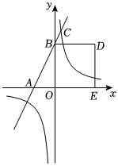

60. （2024•镇江）如图，在平面直角坐标系中，$O$ 为坐标原点，一次函数 $y=2x+m$ 的图象与 $x$ 轴、$y$ 轴交于 $A$（-3，0）、$B$ 两点，与反比例函数 $y=\frac{k}{x}$（$k\neq 0$）的图象交于点 $C$（1，$n$）．（1）求 $m$ 和 $k$ 的值；
（2）已知四边形 $OBDE$ 是正方形，连接 $BE$，点 $P$ 在反比例函数 $y=\frac{k}{x}$（$k\neq 0$）的图象上．当 $\triangle OBP$ 的面积与 $\triangle OBE$ 的面积相等时，直接写出点 $P$ 的坐标 ___ ．

> [!question]- 点击查看答案与解析
> 【答案】（1）$m=6$，$k=8$；（2）$P\left(6,\dfrac{4}{3}\right)$ 或 $P\left(-6,-\dfrac{4}{3}\right)$
> 
> 【考点】待定系数法、正方形坐标与面积相等 → [[【初中数学知识点体系-人教版】#27-1 反比例函数]]、一次函数 → [[【初中数学知识点体系-人教版】#23-1 一次函数]]、特殊的平行四边形 → [[【初中数学知识点体系-人教版】#21-2 特殊的平行四边形]]、坐标方法的简单应用 → [[【初中数学知识点体系-人教版】#9-2 坐标方法的简单应用]]
> 
> 【解析】
> （1）$A(-3,0)$ 代入 $y=2x+m$ 得 $m=6$；$C(1,8)$，$k=8$，$B(0,6)$。
> （2）正方形 $OBDE$ 边长为 $6$，$S_{\triangle OBE}=18$。由 $S_{\triangle OBP}=S_{\triangle OBE}$：$\dfrac{1}{2}\cdot6\cdot|x_P|=18$，$|x_P|=6$，代入 $y=\dfrac{8}{x}$ 得 $P\left(6,\dfrac{4}{3}\right)$ 或 $P\left(-6,-\dfrac{4}{3}\right)$。
> 
> 【易错点】正方形边长等于 $OB$；以 $y$ 轴上线段为底时，高为点横坐标的绝对值。
