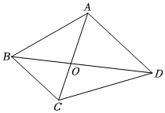
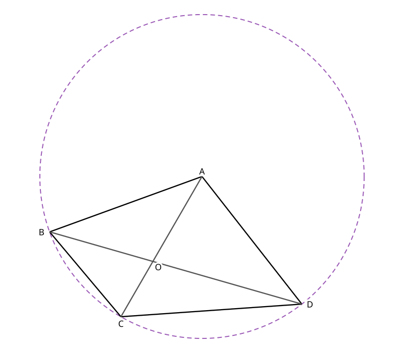

1. （2020秋•铜山区期中）如图，在四边形 $ABCD$ 中，对角线 $AC$、$BD$ 相交于点 $O$，$AB=AC=AD$，若 $\angle BAC=40^\circ$，$\angle DBC=34^\circ$，则 $\angle CAD=$ ___ ．

> [!question]- 点击查看答案与解析
> 【答案】$68^\circ$
> 
> 【考点】定点定长共圆、圆周角定理 → [[【初中数学知识点体系-人教版】#29-1 圆的基本性质]]
> 
> 【解析】
> 由 $AB=AC=AD$ 可知，$B$、$C$、$D$ 三点在以 $A$ 为圆心、$AB$ 为半径的同一个圆上。
> $\angle DBC$ 是弧 $DC$ 所对的圆周角，$\angle CAD$ 是同弧 $DC$ 所对的圆心角，由圆周角定理得 $\angle CAD=2\angle DBC=2\times34^\circ=68^\circ$。
> 
> 
> 【易错点】认准同一条弧：圆周角 $\angle DBC$ 与圆心角 $\angle CAD$ 对应弧 $DC$，勿与已知的 $\angle BAC$（对应弧 $BC$）混淆。