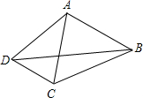
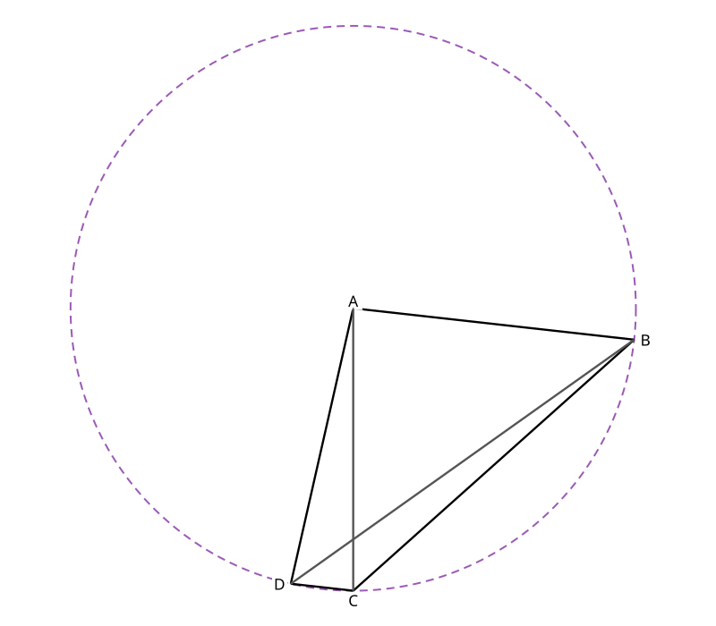

2. （2014秋•青山区期中）如图，在四边形 $ABCD$ 中，$CD\parallel AB$，$CB=4$，$AB=AC=AD=3$，则 $BD$ 的长为 ___ ．

> [!question]- 点击查看答案与解析
> 【答案】$2\sqrt5$
> 
> 【考点】定点定长共圆、坐标法与勾股定理 → [[【初中数学知识点体系-人教版】#29-1 圆的基本性质]]、勾股定理 → [[【初中数学知识点体系-人教版】#20-1 勾股定理]]
> 
> 【解析】
> 由 $AB=AC=AD=3$ 可知，$B$、$C$、$D$ 在以 $A$ 为圆心、半径为 $3$ 的圆上。
> 以 $A$ 为原点、$AB$ 为 $x$ 轴建系，$B(3,0)$。设 $C(3\cos\theta,3\sin\theta)$，由 $CB=4$：$(3\cos\theta-3)^2+(3\sin\theta)^2=16$，化简得 $\cos\theta=\frac19$。
> 由 $CD\parallel AB$ 知 $C$、$D$ 关于过 $A$ 且垂直于 $AB$ 的直线对称，$D(-3\cos\theta,3\sin\theta)$。于是 $BD^2=(-3\cos\theta-3)^2+9\sin^2\theta=18(1+\cos\theta)=20$，故 $BD=2\sqrt5$。
> 
> 
> 【易错点】先由等长条件确定三点共圆，再利用平行关系得到对称位置；弦长公式与坐标勾股配合，避免漏解另一侧的点。