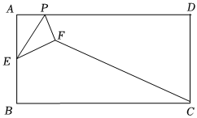
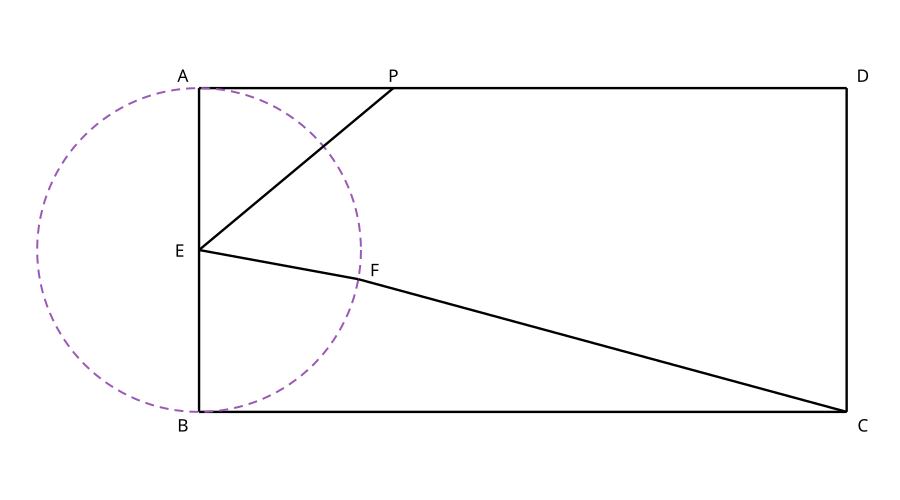

3. （2024春•广州期中）如图，在矩形 $ABCD$ 中，$AB=2$，$BC=4$，点 $E$ 是边 $AB$ 的中点，点 $P$ 是边 $AD$ 上的一个动点，$\triangle PEA$ 关于 $PE$ 的对称图形为 $\triangle PEF$，连接 $CF$．当点 $F$ 恰好落在矩形 $ABCD$ 的对称轴上时，$AP$ 的长为 ___ ；当线段 $CF$ 的长度最小时，$AP$ 的长为 ___ ．

> [!question]- 点击查看答案与解析
> 【答案】当 $F$ 落在对称轴上时 $AP=1$；当 $CF$ 最小时 $AP=\frac{\sqrt{17}+1}{4}$
> 
> 【考点】翻折（轴对称）隐圆、点圆距离最值、勾股定理 → [[【初中数学知识点体系-人教版】#15-1 图形的轴对称]]、圆的基本性质 → [[【初中数学知识点体系-人教版】#29-1 圆的基本性质]]、勾股定理 → [[【初中数学知识点体系-人教版】#20-1 勾股定理]]
> 
> 【解析】
> $E$ 是 $AB$ 中点，$AE=1$；翻折后 $EF=EA=1$，故点 $F$ 在以 $E$ 为圆心、半径为 $1$ 的圆上。
> （1）矩形的水平对称轴与该圆交于矩形内一点 $F$，竖直对称轴与圆无交点；此时 $PE$ 为 $AF$ 的中垂线，求得 $AP=1$。
> （2）$C$ 为定点，$CE=\sqrt{4^2+1^2}=\sqrt{17}$，$CF$ 最小时 $F$ 在线段 $CE$ 上，$CF_{\min}=\sqrt{17}-1$。由 $PE\perp AF$ 列垂直条件，求得此时 $AP=\frac{\sqrt{17}+1}{4}$。
> 
> 
> 【易错点】翻折对应边 $EF=EA=1$ 是定长隐圆的关键；最小值为圆心距减半径，注意轨迹圆上位于矩形内部的弧段才可取。