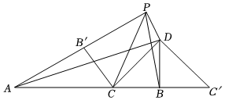
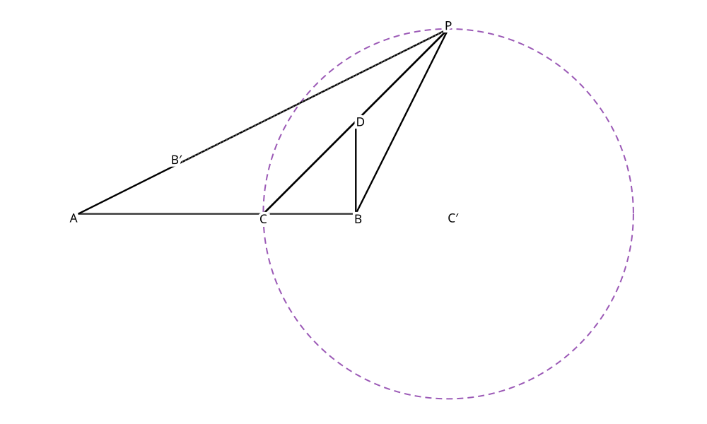

4. （2022•槐荫区一模）如图，线段 $AB=6$，在线段 $AB$ 上有一点 $C$，当 $BC=2$ 时，以 $BC$ 为直角边在 $AB$ 上方作等腰 Rt$\triangle DBC$，$\angle DBC=90^\circ$，$P$ 为平面内一点，连接 $PB$，$PC$，将 $\triangle DBC$ 和 $\triangle PCB$ 分别沿 $DB$，$PC$ 翻折得到 $\triangle DBC'$ 和 $\triangle PCB'$，若 $A$、$B'$、$P$ 恰好共线，则线段 $PD$ 的最小值是 ___ ．

> [!question]- 点击查看答案与解析
> 【答案】$4-2\sqrt2$
> 
> 【考点】翻折全等、角平分线定理、阿波罗尼斯隐圆与点圆距离 → [[【初中数学知识点体系-人教版】#15-1 图形的轴对称]]、角的平分线 → [[【初中数学知识点体系-人教版】#14-3 角的平分线]]、圆的基本性质 → [[【初中数学知识点体系-人教版】#29-1 圆的基本性质]]
> 
> 【解析】
> 第二次翻折后 $CB'=CB=2$，$PB'=PB$，直线 $PC$ 是线段 $BB'$ 的中垂线，平分 $\angle BPB'$。
> 由 $A$、$B'$、$P$ 共线，$PC$ 平分 $\triangle APB$ 中的 $\angle APB$。由角平分线定理，$\frac{AP}{PB}=\frac{AC}{CB}=\frac{4}{2}=2$，即 $PA=2PB$。
> 建系 $A(0,0)$、$B(6,0)$，设 $P(x,y)$，由 $PA^2=4PB^2$ 化简得 $(x-8)^2+y^2=16$，即 $P$ 的轨迹是以 $(8,0)$ 为圆心、半径 $4$ 的圆。$D(6,2)$ 到圆心距离为 $\sqrt{(8-6)^2+(0-2)^2}=2\sqrt2$，点 $D$ 在圆内，故 $PD_{\min}=4-2\sqrt2$。
> 
> 
> 【易错点】角平分线定理的比例要找准邻边（$AP:PB=AC:CB$）；当定点在轨迹圆内时，最小值为半径减圆心距，不要误用圆心距减半径。