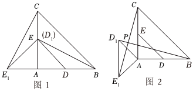
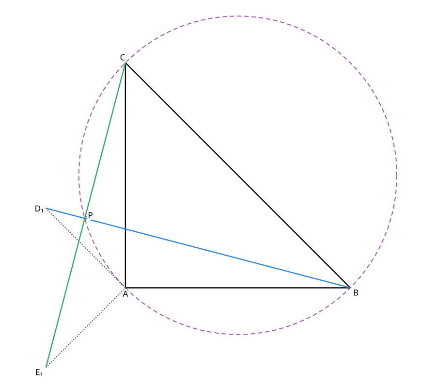

5. （2015•汕尾）在 Rt$\triangle ABC$ 中，$\angle A=90^\circ$，$AC=AB=4$，$D$，$E$ 分别是边 $AB$，$AC$ 的中点，若等腰 Rt$\triangle ADE$ 绕点 $A$ 逆时针旋转，得到等腰 Rt$\triangle AD_{1}E_{1}$，设旋转角为 $\alpha$（$0<\alpha\le 180^\circ$），记直线 $BD_{1}$ 与 $CE_{1}$ 的交点为 $P$．

（1）如图1，当 $\alpha=90^\circ$ 时，线段 $BD_{1}$ 的长等于 ___ ，线段 $CE_{1}$ 的长等于 ___ ；（直接填写结果）

（2）如图2，当 $\alpha=135^\circ$ 时，求证：$BD_{1}=CE_{1}$，且 $BD_{1}\perp CE_{1}$；

（3）求点 $P$ 到 $AB$ 所在直线的距离的最大值．（直接写出结果）

> [!question]- 点击查看答案与解析
> 【答案】（1）$BD_1=2\sqrt5$，$CE_1=2\sqrt5$；（2）见解析；（3）点 $P$ 到 $AB$ 的距离最大值为 $1+\sqrt3$
> 
> 【考点】旋转全等、定边对直角隐圆、勾股定理 → [[【初中数学知识点体系-人教版】#28-1 图形的旋转]]、三角形全等的判定 → [[【初中数学知识点体系-人教版】#14-2 三角形全等的判定]]、圆的基本性质 → [[【初中数学知识点体系-人教版】#29-1 圆的基本性质]]
> 
> 【解析】
> （1）$D$、$E$ 为中点，$AD=AE=2$。当 $\alpha=90^\circ$ 时，由坐标（或勾股定理）得 $BD_1=CE_1=\sqrt{4^2+2^2}=2\sqrt5$。
> （2）由旋转知 $AD_1=AE_1$，$\angle D_1AB=\angle E_1AC=135^\circ$，又 $AB=AC$，故 $\triangle D_1AB\cong\triangle E_1AC$（SAS），于是 $BD_1=CE_1$，且 $\angle D_1BA=\angle E_1CA$。设 $BD_1$ 与 $AC$ 交于 $F$，由 $\angle BFA=\angle CFP$ 得 $\angle CPF=\angle FAB=90^\circ$，故 $BD_1\perp CE_1$。
> （3）由 $BD_1\perp CE_1$ 知 $\angle BPC=90^\circ$，点 $P$ 在以 $BC$ 为直径的圆上。当 $BD_1$ 与以 $A$ 为心、$2$ 为半径的圆相切，四边形 $AD_1PE_1$ 为正方形时，$P$ 到 $AB$ 的距离最大，求得最大值为 $1+\sqrt3$。
> 
> 
> 【易错点】旋转全等的两组对应边与夹角要对应准确；轨迹圆直径为 $BC$；最大距离出现在相切临界位置，不要直接取轨迹圆最高点。