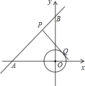
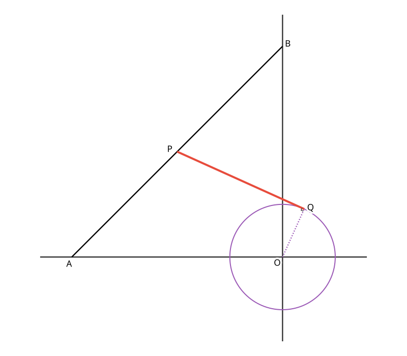

6. （2022秋•东平县校级期末）如图，在平面直角坐标系 $xOy$ 中，直线 $AB$ 经过点 $A$（-4，0）、$B$（0，4），$\odot O$ 的半径为 1（$O$ 为坐标原点），点 $P$ 在直线 $AB$ 上，过点 $P$ 作 $\odot O$ 的一条切线 $PQ$，$Q$ 为切点，则切线长 $PQ$ 的最小值为（　　）

A. $\sqrt{6}$

B. $\sqrt{7}$

C. $2\sqrt{2}$

D. 3

> [!question]- 点击查看答案与解析
> 【答案】B，$\sqrt7$
> 
> 【考点】切线性质、点到直线距离、勾股定理 → [[【初中数学知识点体系-人教版】#30-1 直线和圆的位置关系]]、勾股定理 → [[【初中数学知识点体系-人教版】#20-1 勾股定理]]
> 
> 【解析】
> 由切线性质 $OQ\perp PQ$，在 $\mathrm{Rt}\triangle OPQ$ 中 $PQ^2=OP^2-OQ^2=OP^2-1$，故 $PQ$ 最小等价于 $OP$ 最小。
> 直线 $AB$ 过 $A(-4,0)$、$B(0,4)$，方程为 $x-y+4=0$。原点到该直线的距离 $OP_{\min}=\frac{|4|}{\sqrt2}=2\sqrt2$。
> 于是 $PQ_{\min}=\sqrt{(2\sqrt2)^2-1}=\sqrt7$，选 B。
> 
> 
> 【易错点】切线长用勾股定理 $PQ=\sqrt{OP^2-r^2}$；$OP$ 的最小值是原点到直线的垂线段，不是到坐标轴交点的距离。