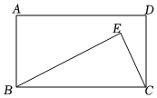
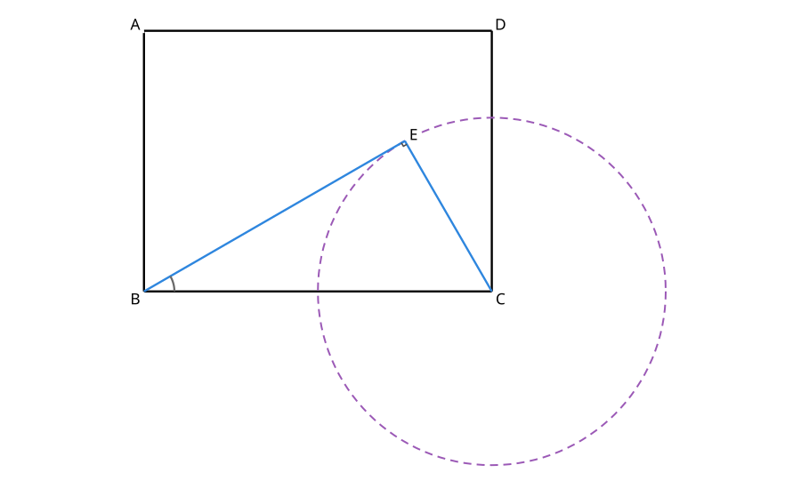

7. 如图，已知四边形 $ABCD$ 是矩形，$BC=4$，$AB>2$，若 $CE=2$，且点 $E$ 在矩形 $ABCD$ 的内部，则 $\angle ABE$ 的取值范围为 ___ ．

> [!question]- 点击查看答案与解析
> 【答案】$60^\circ\le\angle ABE<90^\circ$
> 
> 【考点】定点定长隐圆、切线与锐角三角函数 → [[【初中数学知识点体系-人教版】#29-1 圆的基本性质]]、锐角三角函数 → [[【初中数学知识点体系-人教版】#32-1 锐角三角函数]]
> 
> 【解析】
> 由 $CE=2$，点 $E$ 在以 $C$ 为圆心、半径为 $2$ 的圆上；又 $E$ 在矩形内部，故轨迹为该圆落在矩形内的左上四分之一圆弧。
> 过 $B$ 作圆 $C$ 的切线，$BC=4$，半径 $r=2$，切线与 $BC$ 的夹角 $\beta$ 满足 $\sin\beta=\frac{r}{BC}=\frac12$，故 $\beta=30^\circ$。
> $\angle ABE=90^\circ-\angle EBC$，而 $\angle EBC\in[0^\circ,30^\circ]$（$E$ 在 $BC$ 上为边界位置，不取到），所以 $60^\circ\le\angle ABE<90^\circ$。
> 
> 
> 【易错点】点 $E$ 在矩形内部，落在 $BC$ 边上的临界位置不取，故 $90^\circ$ 为开区间；角的上界由切线位置确定。