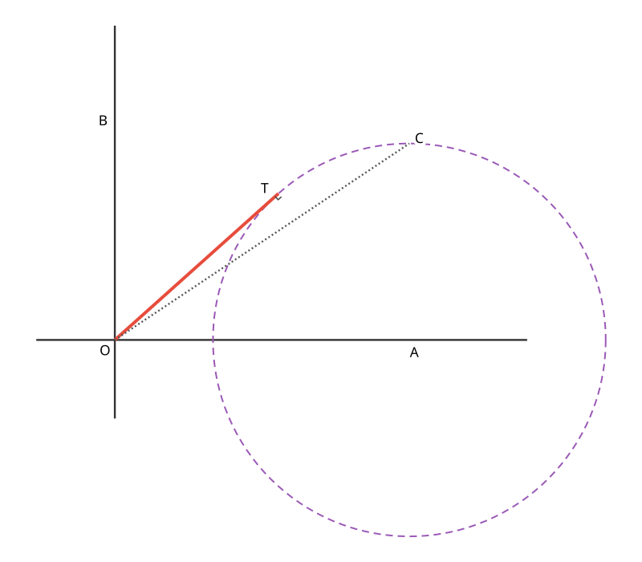

8. （2024•鼓楼区校级模拟）在平面直角坐标系中，点 $A$ 的坐标为（3，0），点 $B$ 为 $y$ 轴正半轴上的一点，点 $C$ 是第一象限内一点，且 $AC=2$．设 $\tan\angle BOC=m$，则 $m$ 的取值范围是（　　）

A. $m\ge\sqrt{2}$

B. $m\ge3$

C. $\sqrt{2}-1\le m\le\sqrt{2}+1$

D. $m\ge\frac{\sqrt{5}}{2}$

> [!question]- 点击查看答案与解析
> 【答案】D，$m\ge\frac{\sqrt5}{2}$
> 
> 【考点】定点定长隐圆、切线斜率与锐角三角函数、坐标应用 → [[【初中数学知识点体系-人教版】#29-1 圆的基本性质]]、锐角三角函数 → [[【初中数学知识点体系-人教版】#32-1 锐角三角函数]]、坐标方法的简单应用 → [[【初中数学知识点体系-人教版】#9-2 坐标方法的简单应用]]
> 
> 【解析】
> 由 $AC=2$，点 $C$ 在以 $A(3,0)$ 为圆心、半径为 $2$ 的圆上，取第一象限的一段弧。
> 设直线 $OC$ 的斜率为 $k=\frac{y}{x}$，则 $m=\tan\angle BOC=\frac{x}{y}=\frac1k$。从原点 $O$ 作圆 $A$ 的切线，$OA=3$，$r=2$，切线斜率的最大值 $k_{\max}=\frac{r}{\sqrt{OA^2-r^2}}=\frac{2}{\sqrt5}$。
> 故 $m_{\min}=\frac{\sqrt5}{2}$，且 $m$ 无上界，即 $m\ge\frac{\sqrt5}{2}$，选 D。
> 
> 
> 【易错点】$m$ 是余切值（水平分量比竖直分量），与直线斜率互为倒数；第一象限弧对应单侧范围，注意切线是临界位置。