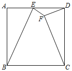
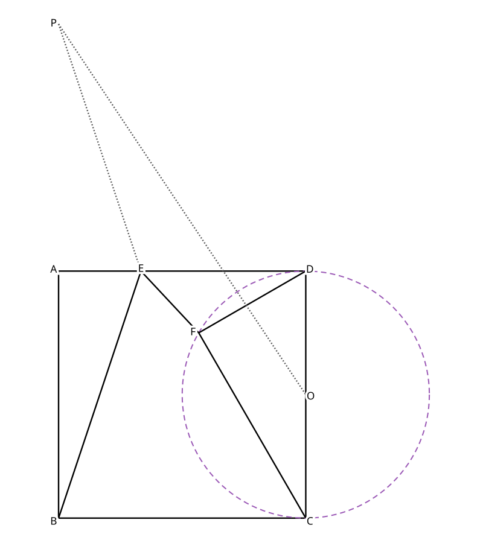

9. （2021•鄂尔多斯）如图，已知正方形 $ABCD$ 的边长为 6，点 $F$ 是正方形内一点，连接 $CF$，$DF$，且 $\angle ADF=\angle DCF$，点 $E$ 是 $AD$ 边上一动点，连接 $EB$，$EF$，则 $EB+EF$ 长度的最小值为 ___ ．

> [!question]- 点击查看答案与解析
> 【答案】$3\sqrt{13}-3$
> 
> 【考点】定边对直角隐圆、轴对称最短路径（将军饮马）、勾股定理 → [[【初中数学知识点体系-人教版】#29-1 圆的基本性质]]、图形的轴对称 → [[【初中数学知识点体系-人教版】#15-1 图形的轴对称]]、勾股定理 → [[【初中数学知识点体系-人教版】#20-1 勾股定理]]
> 
> 【解析】
> 由 $\angle ADF=\angle DCF$，又 $\angle ADF+\angle CDF=90^\circ$，得 $\angle DCF+\angle CDF=90^\circ$，即 $\angle DFC=90^\circ$，故 $F$ 在以 $CD$ 为直径的半圆上，半径为 $3$。
> 作正方形关于直线 $AD$ 的对称图形，点 $B$ 的对称点记为 $P$，由轴对称 $EB=EP$，于是 $EB+EF=EP+EF\ge PF$。
> 设 $CD$ 中点为 $O$（半圆的圆心），则 $OF=3$，$OP=\sqrt{6^2+9^2}=3\sqrt{13}$，故 $PF_{\min}=OP-OF=3\sqrt{13}-3$。
> 
> 
> 【易错点】先由两角互余定出直角隐圆；将军饮马对称转换后，再用圆外一点到圆上的最短距离（圆心距减半径）。