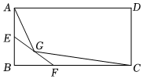
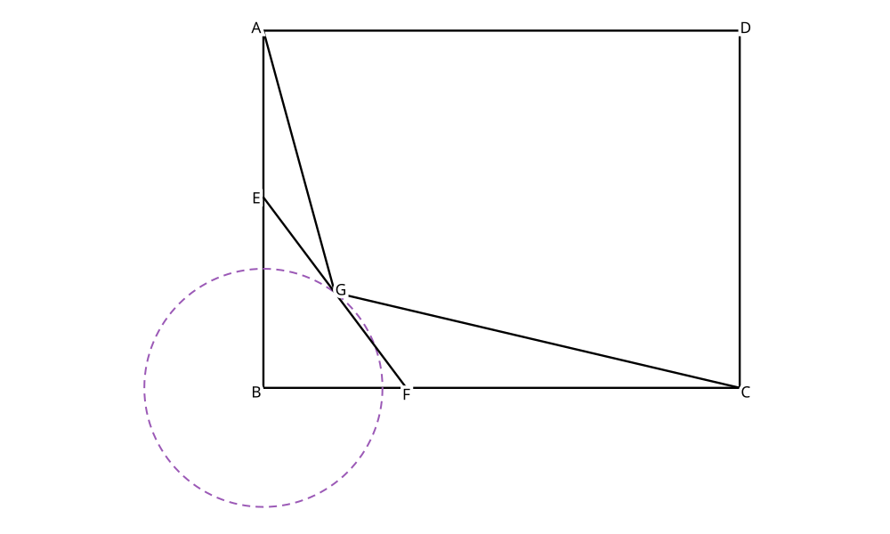

10. （2024秋•西城区校级期中）如图，在矩形 $ABCD$ 中，$AB=6$，$BC=8$，点 $E$、$F$ 分别是边 $AB$，$BC$ 上的动点，且 $EF=4$，点 $G$ 是 $EF$ 的中点，连接 $AG$，$CG$，则四边形 $AGCD$ 面积的最小值为（　　）

A. 30

B. 32

C. 35

D. 38

> [!question]- 点击查看答案与解析
> 【答案】D，$38$
> 
> 【考点】直角三角形斜边中线定长隐圆、矩形面积与线性最值 → [[【初中数学知识点体系-人教版】#13-2 与三角形有关的线段]]、圆的基本性质 → [[【初中数学知识点体系-人教版】#29-1 圆的基本性质]]、特殊的平行四边形 → [[【初中数学知识点体系-人教版】#21-2 特殊的平行四边形]]
> 
> 【解析】
> $\angle EBF=90^\circ$，$G$ 是斜边 $EF$ 的中点，故 $BG=\frac{EF}{2}=2$，点 $G$ 在以 $B$ 为圆心、半径为 $2$ 的圆上（矩形内一段弧）。
> 建系 $B(0,0)$、$A(0,6)$、$C(8,0)$，设 $G(x,y)$。矩形面积为 $48$，$S_{\triangle ABG}=3x$，$S_{\triangle BCG}=4y$，故 $S_{AGCD}=48-3x-4y$。
> 在圆 $x^2+y^2=4$ 上，$3x+4y$ 的最大值为 $2\sqrt{3^2+4^2}=10$，所以 $S_{AGCD,\min}=48-10=38$，选 D。
> 
> 
> 【易错点】斜边中线等于斜边一半，先定出 $G$ 的隐圆；四边形面积转化为线性式 $3x+4y$ 的最值，用几何意义（或柯西不等式）求最大。