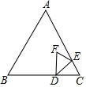
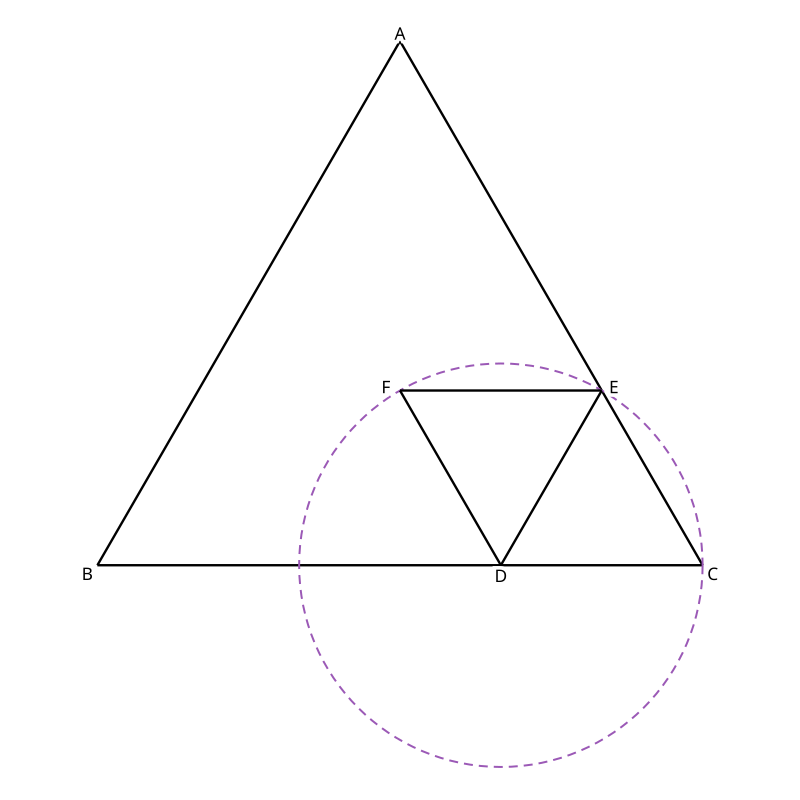

11. （2019•广州）如图，等边 $\triangle ABC$ 中，$AB=6$，点 $D$ 在 $BC$ 上，$BD=4$，点 $E$ 为边 $AC$ 上一动点（不与点 $C$ 重合），$\triangle CDE$ 关于 $DE$ 的轴对称图形为 $\triangle FDE$．

（1）当点 $F$ 在 $AC$ 上时，求证：$DF\parallel AB$；

（2）设 $\triangle ACD$ 的面积为 $S_{1}$，$\triangle ABF$ 的面积为 $S_{2}$，记 $S=S_{1}-S_{2}$，$S$ 是否存在最大值？若存在，求出 $S$ 的最大值；若不存在，请说明理由；

（3）当 $B$，$F$，$E$ 三点共线时，求 $AE$ 的长．

> [!question]- 点击查看答案与解析
> 【答案】（1）见解析；（2）$S$ 的最大值为 $6-3\sqrt3$；（3）$AE=7-\sqrt{13}$
> 
> 【考点】翻折全等、等边三角形性质、隐圆面积最值、勾股定理与相似 → [[【初中数学知识点体系-人教版】#15-1 图形的轴对称]]、三角形的内角与外角 → [[【初中数学知识点体系-人教版】#13-3 三角形的内角与外角]]、勾股定理 → [[【初中数学知识点体系-人教版】#20-1 勾股定理]]
> 
> 【解析】
> （1）由折叠知 $DF=DC=2$。当 $F$ 在 $AC$ 上时，$\triangle DCF$ 为等边三角形，$\angle FDC=60^\circ=\angle B$，故 $DF\parallel AB$。
> （2）$CD=2$，等边三角形的高为 $3\sqrt3$，故 $S_1=S_{\triangle ACD}=3\sqrt3$ 为定值。$F$ 在以 $D$ 为圆心、$2$ 为半径的圆上，$S_2=S_{\triangle ABF}=3\cdot FG$；当 $F$ 落在 $D$ 到 $AB$ 的垂线段上时，$FG=2\sqrt3-2$，$S_{2\min}=6\sqrt3-6$，于是 $S_{\max}=3\sqrt3-(6\sqrt3-6)=6-3\sqrt3$。
> （3）当 $B$、$F$、$E$ 共线时，作 $DG\perp EF$、$EH\perp BC$。在 $\mathrm{Rt}\triangle DFP$ 中 $PF=1$、$PD=\sqrt3$，在 $\mathrm{Rt}\triangle BPD$ 中 $BP=\sqrt{13}$；由相似求得 $CE=\sqrt{13}-1$，故 $AE=6-CE=7-\sqrt{13}$。
> 
> 
> 【易错点】翻折前后对应边、对应角相等；面积最值转化为高 $FG$ 的最值；三点共线时注意 $E$ 不与 $C$ 重合，相似三角形的对应边不要配错。