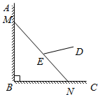
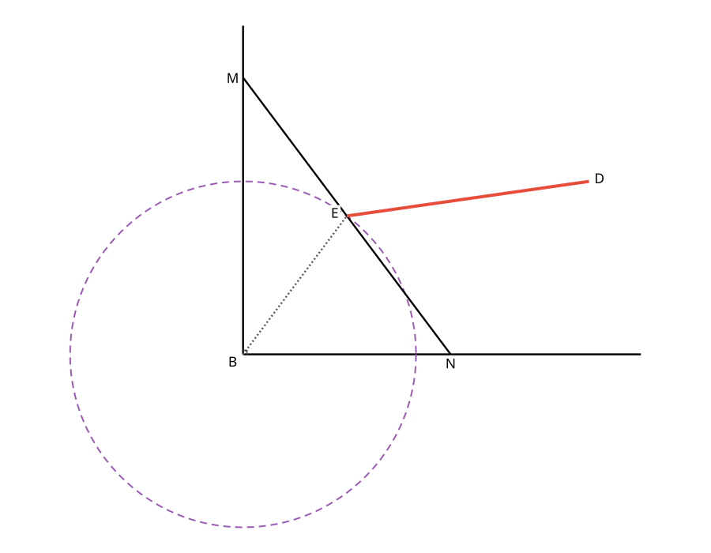

12. （2020•广东）有一架竖直靠在直角墙面的梯子正在下滑，一只猫紧紧盯住位于梯子正中间的老鼠，等待与老鼠距离最小时扑捉．把墙面、梯子、猫和老鼠都理想化为同一平面内的线或点，模型如图，$\angle ABC=90^\circ$，点 $M$，$N$ 分别在射线 $BA$，$BC$ 上，$MN$ 长度始终保持不变，$MN=4$，$E$ 为 $MN$ 的中点，点 $D$ 到 $BA$，$BC$ 的距离分别为 4 和 2．在此滑动过程中，猫与老鼠的距离 $DE$ 的最小值为 ___ ．

> [!question]- 点击查看答案与解析
> 【答案】$2\sqrt5-2$
> 
> 【考点】直角三角形斜边中线定长隐圆、点圆距离最值 → [[【初中数学知识点体系-人教版】#13-2 与三角形有关的线段]]、圆的基本性质 → [[【初中数学知识点体系-人教版】#29-1 圆的基本性质]]
> 
> 【解析】
> $\triangle MBN$ 为直角三角形，$E$ 是斜边 $MN$ 的中点，故 $BE=\frac{MN}{2}=2$，点 $E$ 的轨迹是以 $B$ 为圆心、半径为 $2$ 的四分之一圆。
> 点 $D$ 到两直角边的距离分别为 $4$ 和 $2$，故 $BD=\sqrt{4^2+2^2}=2\sqrt5$。
> 由点圆距离最小值公式，$DE_{\min}=BD-2=2\sqrt5-2$。
> 
> 
> 【易错点】直角三角形斜边中线等于斜边的一半；最小值为圆心距减半径，注意轨迹只在第一象限的四分之一圆上。