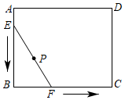
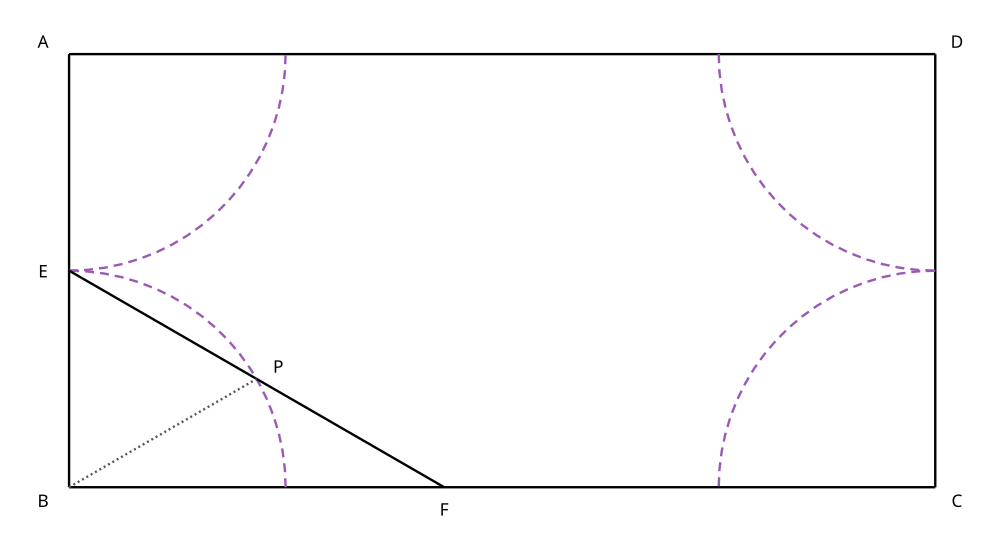

13. （2020•浙江自主招生）如图，在矩形 $ABCD$ 中，已知 $AB=2$ cm，$BC=4$ cm，现有一根长为 $2$ cm 的木棒 $EF$ 紧贴着矩形的边（即两个端点始终落在矩形的边上），按逆时针方向滑动一周，则木棒 $EF$ 的中点 $P$ 在运动过程中所围成的图形的面积为（　　）

A. $(8-\pi)\mathrm{cm}^2$

B. $4\mathrm{cm}^2$

C. $(3+\pi)\mathrm{cm}^2$

D. $8\mathrm{cm}^2$

> [!question]- 点击查看答案与解析
> 【答案】A，$(8-\pi)\mathrm{cm}^2$
> 
> 【考点】斜边中线定长隐圆、轨迹围成面积 → [[【初中数学知识点体系-人教版】#13-2 与三角形有关的线段]]、圆的基本性质 → [[【初中数学知识点体系-人教版】#29-1 圆的基本性质]]
> 
> 【解析】
> 木棒两端落在矩形相邻两边上，夹角为矩形顶角（直角），$EF=2$，中点 $P$ 到该顶角的距离为 $1$；在每个顶角处，$P$ 的轨迹是半径为 $1$ 的四分之一圆弧。
> 四个四分之一圆弧合成一个半径为 $1$ 的整圆，面积为 $\pi$；矩形面积为 $2\times4=8$。
> 中点 $P$ 可达区域的面积为矩形面积减去四个角上的扇形面积，即 $8-\pi$，选 A。
> 
> 
> 【易错点】中点到直角顶点的距离为定长 $1$；围成面积是减去角上的四分之一圆，不要误加扇形面积。