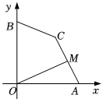
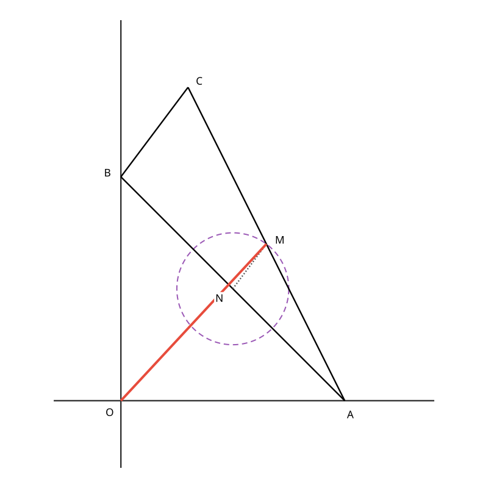

14. 如图，点 $A$，$B$ 的坐标分别为 $A$（2，0），$B$（0，2），点 $C$ 为坐标平面内一点，$BC=1$，点 $M$ 为线段 $AC$ 的中点，连接 $OM$，则 $OM$ 的最大值为（　　）

A. $1+\sqrt{2}$

B. $\frac{1}{2}+\sqrt{2}$

C. $1+2\sqrt{2}$

D. $2\sqrt{2}-1$

> [!question]- 点击查看答案与解析
> 【答案】B，$\frac12+\sqrt2$
> 
> 【考点】三角形中位线定长隐圆、点圆距离最大值 → [[【初中数学知识点体系-人教版】#13-2 与三角形有关的线段]]、圆的基本性质 → [[【初中数学知识点体系-人教版】#29-1 圆的基本性质]]
> 
> 【解析】
> 取 $AB$ 的中点 $N$，在 $\triangle ABC$ 中，$M$ 是 $AC$ 中点，故 $MN$ 为中位线，$MN=\frac{BC}{2}=\frac12$，点 $M$ 的轨迹是以 $N$ 为圆心、半径为 $\frac12$ 的圆。
> $A(2,0)$、$B(0,2)$，故 $N(1,1)$，$ON=\sqrt2$。
> 由点圆距离最大值公式，$OM_{\max}=ON+\frac12=\sqrt2+\frac12$，选 B。
> 
> 
> 【易错点】中位线平行于第三边且等于其一半，先定出隐圆；最大值为圆心距加半径。