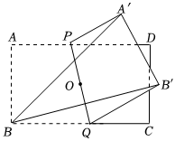
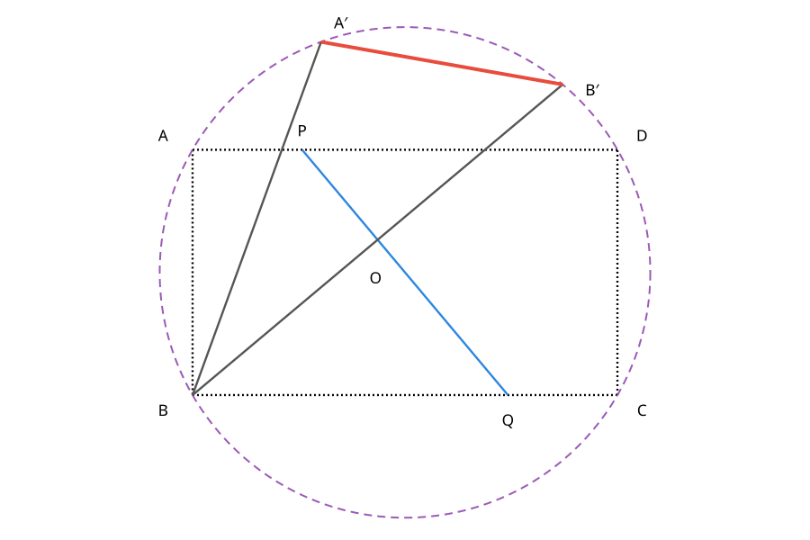

15. （2025•济南一模）如图，在矩形纸片 $ABCD$ 中，$AB=1$，$BC=\sqrt{3}$，点 $O$ 是对称中心，点 $P$、$Q$ 分别在边 $AD$，$BC$ 上，且 $PQ$ 经过点 $O$．将该纸片沿 $PQ$ 折叠，使点 $A$，$B$ 分别落在点 $A'$，$B'$ 的位置，则 $\triangle BA'B'$ 面积的最大值为 ___ ．

> [!question]- 点击查看答案与解析
> 【答案】$\frac{2+\sqrt3}{4}$
> 
> 【考点】折叠保距隐圆、矩形性质与三角最值 → [[【初中数学知识点体系-人教版】#15-1 图形的轴对称]]、特殊的平行四边形 → [[【初中数学知识点体系-人教版】#21-2 特殊的平行四边形]]、圆的基本性质 → [[【初中数学知识点体系-人教版】#29-1 圆的基本性质]]
> 
> 【解析】
> $O$ 是矩形对称中心，折叠后 $OA'=OA$，$OB'=OB$。矩形对角线长 $\sqrt{1^2+(\sqrt3)^2}=2$，故 $OA=OB=1$，$A'$、$B'$ 都在以 $O$ 为圆心、半径为 $1$ 的圆上。
> 设折痕 $PQ$ 与 $OB$ 方向的夹角为 $\theta$（由 $P\in AD$、$Q\in BC$ 约束 $\theta\in[-60^\circ,60^\circ]$）。反射不改变 $OA'$ 与 $OB'$ 的夹角，用坐标表示 $\triangle BA'B'$ 的面积并化简，得 $S=\frac12\left(\frac{\sqrt3}{2}+\sin(60^\circ+2\theta)\right)$。
> 当 $60^\circ+2\theta=90^\circ$，即 $\theta=15^\circ$（在可取范围内）时面积最大，$S_{\max}=\frac{2+\sqrt3}{4}$。
> 
> 
> 【易错点】折叠保距先定出 $A'$、$B'$ 的隐圆；面积化简后要结合折痕位置的取值范围判断临界角是否可达，不能直接取三角函数的全域最值。