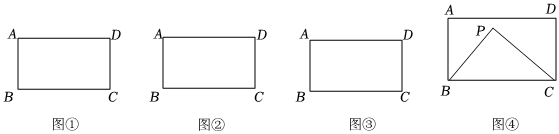
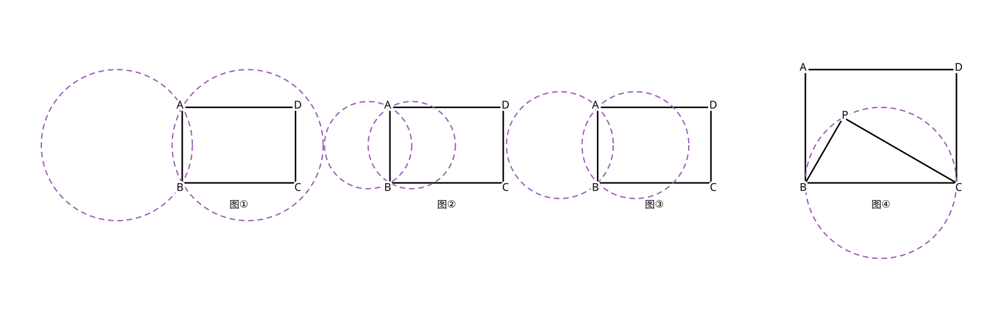

1. 如图，已知矩形 $ABCD$．

（1）如图 $①$，请在矩形 $ABCD$ 的边上画出使 $\angle APB=30^\circ$ 的所有点 $P$；

（2）如图 $②$，请在矩形 $ABCD$ 的内部或边上画出使 $\angle APB=60^\circ$ 的点 $P$ 的轨迹；

（3）如图 $③$，请在矩形 $ABCD$ 的内部或边上画出使 $\angle APB=45^\circ$ 的点 $P$ 的轨迹；

（4）如图 $④$，已知 $AB=3$，$BC=4$，点 $P$ 是矩形 $ABCD$ 内一点，且 $\angle PBC=\angle PCD$，求 $\triangle PBC$ 面积的最大值．

> [!question]- 点击查看答案与解析
> 【答案】（1）以 $AB$ 为弦、所含圆周角为 $30^\circ$ 的两段圆弧与矩形各边的交点，即为所有满足条件的点 $P$；（2）以 $AB$ 为弦、所含圆周角为 $60^\circ$ 的圆弧落在矩形内部（含边）的部分，即为点 $P$ 的轨迹；（3）以 $AB$ 为弦、所含圆周角为 $45^\circ$ 的圆弧落在矩形内部（含边）的部分，即为点 $P$ 的轨迹；（4）$\triangle PBC$ 面积的最大值为 $4$。
> 
> 【考点】定弦定角隐圆轨迹作图、矩形内面积最值 → [[【初中数学知识点体系-人教版】#29-1 圆的基本性质]]、特殊的平行四边形（矩形） → [[【初中数学知识点体系-人教版】#21-2 特殊的平行四边形]]
> 
> 【解析】
> 定弦定角模型：对定线段 $AB$ 张角为定角 $\alpha$ 的点 $P$，其轨迹是以 $AB$ 为弦、所含圆周角为 $\alpha$ 的两段圆弧（$AB$ 两侧各一段），取圆弧与矩形边或内部的公共部分即可完成（1）（2）（3）的作图。
> （4）设 $BC=4$ 为底边，$AB=3$。由 $\angle PBC=\angle PCD$，设 $P(x,h)$，可推得 $(x-2)^2+h^2=4$，即 $P$ 在以 $BC$ 中点为圆心、半径为 $2$ 的上半圆上运动。
> $\triangle PBC$ 的面积 $S=\frac12\cdot BC\cdot h=2h$，当 $P$ 运动到圆弧最高点时 $h$ 取最大值 $2$，故 $S_{\max}=2\times 2=4$。
> 
> 
> 【易错点】定角轨迹是两段圆弧，不要只画一侧；第（4）问面积最值转化为轨迹圆上的点到底边的距离最值，注意只取矩形内部的弧段。
