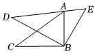
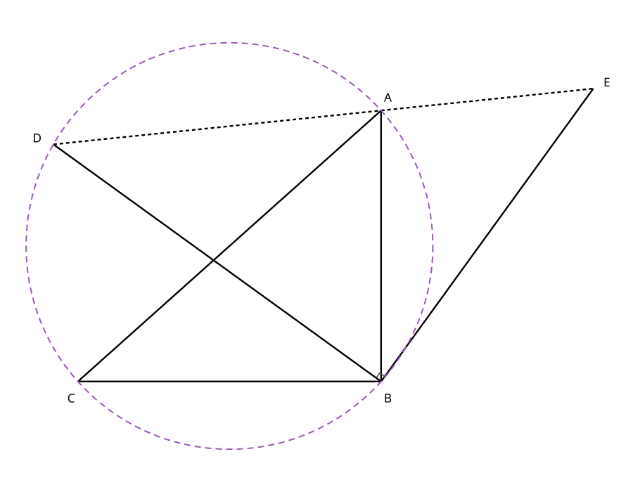

2. （2025•常熟市模拟）如图 $\triangle ABC$ 中，$\angle ABC=90^\circ$，$AB=2$，$BC=\sqrt{5}$，$D$ 为平面内一点，且 $\angle BDA=\angle C$，过点 $B$ 作 $BE\perp BD$，与 $DA$ 的延长线相交于点 $E$，则 $\triangle BDE$ 面积的最大值为（　　）

A. $\sqrt{5}$

B. $\frac{9\sqrt{5}}{5}$

C. $2\sqrt{5}$

D. $\frac{18\sqrt{5}}{5}$

> [!question]- 点击查看答案与解析
> 【答案】B
> 
> 【考点】定弦定角隐圆、直角三角形面积最值 → [[【初中数学知识点体系-人教版】#29-1 圆的基本性质]]、三角形内角与外角 → [[【初中数学知识点体系-人教版】#13-3 三角形的内角与外角]]
> 
> 【解析】
> 在 Rt$\triangle ABC$ 中，$AC=\sqrt{AB^2+BC^2}=\sqrt{4+5}=3$，$\sin C=\frac{AB}{AC}=\frac23$，$\tan C=\frac{AB}{BC}=\frac{2}{\sqrt5}$。
> $\angle BDA=\angle C$ 为定角，定弦为 $AB$，故点 $D$ 的轨迹是以 $AB$ 为弦、所含圆周角等于 $\angle C$ 的圆。其半径 $R=\frac{AB}{2\sin C}=\frac{2}{2\times 2/3}=\frac32$；点 $B$ 是该圆弦的端点，$BD$ 的最大值为直径 $2R=3$。
> $BE\perp BD$，故 $\triangle BDE$ 为直角三角形，$\angle BDE=\angle BDA=\angle C$，$BE=BD\cdot\tan C$。
> $S_{\triangle BDE}=\frac12 BD\cdot BE=\frac12 BD^2\tan C\le \frac12\times 3^2\times\frac{2}{\sqrt5}=\frac{9\sqrt5}{5}$。
> - 选项A：$\sqrt5$，偏小，错误；
> - 选项B：$\frac{9\sqrt5}{5}$，正确；
> - 选项C：$2\sqrt5$，偏大，错误；
> - 选项D：$\frac{18\sqrt5}{5}$，为未乘 $\frac12$ 的结果，错误。
> 
> 
> 【易错点】先由定弦定角确定隐圆半径，再把面积最值转化为 $BD$ 的直径最值；勿把 $\tan C$ 写成 $\frac{BC}{AB}$。
